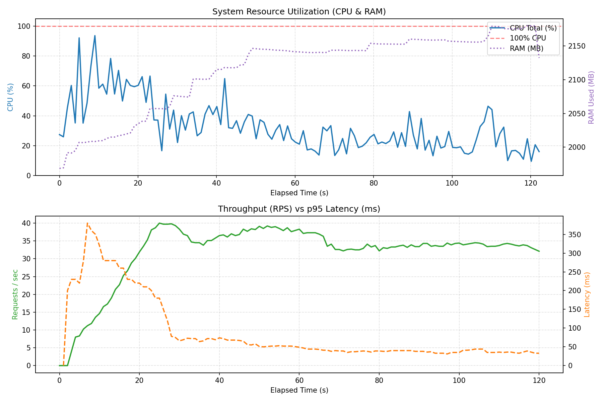

# KTPM - Hệ thống Quản lý Kho hàng, Khách hàng và Đơn hàng

## Mục lục

- [Phần 1: Mô tả bài toán và nghiệp vụ cơ bản](#phần-1-mô-tả-bài-toán-và-nghiệp-vụ-cơ-bản)
- [Phần 2: Đặc tả các API (RESTful API Specification)](#phần-2-đặc-tả-các-api-restful-api-specification)
- [Phần 3: Một số vấn đề của hệ thống (đã xử lý ở Phase 1)](#phần-3-một-số-vấn-đề-của-hệ-thống-đã-xử-lý-ở-phase-1)
- [Phần 4: Những điểm gợi ý cải tiến ở Phase 2](#phần-4-những-điểm-gợi-ý-cải-tiến-ở-phase-2)
- [Phần 5: Tổ chức mã nguồn](#phần-5-tổ-chức-mã-nguồn)
- [Phần 6: Cài đặt và triển khai (Deploy)](#phần-6-cài-đặt-và-triển-khai-deploy)
- [Phần 7: Thử nghiệm tải và đo đạc hiệu năng trên Kaggle (Benchmark & Load Testing)](#phần-7-thử-nghiệm-tải-và-đo-đạc-hiệu-năng-trên-kaggle-benchmark--load-testing)

---

## PHẦN 1: MÔ TẢ BÀI TOÁN VÀ NGHIỆP VỤ CƠ BẢN

### 1.1. Tổng quan bài toán

Hệ thống cung cấp nền tảng quản lý kho hàng, quan hệ khách hàng thông qua giao thức RESTful API. Mục tiêu cốt lõi là số hóa quy trình vận hành thương mại, chăm sóc khách hàng, kiểm soát hàng hóa và xử lý giao dịch đơn hàng.

### 1.2. Mô hình thực thể cốt lõi

| Thực thể | Vai trò trong hệ thống | Mối quan hệ nghiệp vụ |
| :--- | :--- | :--- |
| 1. User | Tài khoản định danh truy cập hệ thống. | Phân quyền người dùng (ADMIN / USER), xác thực qua JWT. |
| 2. Customer | Hồ sơ khách hàng mua sắm. | Lưu trữ thông tin liên hệ và sở hữu lịch sử nhiều đơn hàng. |
| 3. Product | Danh mục hàng hóa thương mại. | Quản lý đơn giá và tồn kho; tham chiếu trong chi tiết đơn hàng. |
| 4. Order & Order Details | Giao dịch mua bán. | Kết nối Customer và danh sách Product trong một giao dịch duy nhất. |

### 1.3. Quy trình và quy tắc nghiệp vụ cơ bản

Chi tiết quy trình và quy tắc nghiệp vụ của từng phân hệ (Xác thực & Phân quyền, Khách hàng, Tồn kho, Đơn hàng & Sơ đồ trạng thái):
- Xem chi tiết tại: [`docs/business-rules.md`](./docs/business-rules.md)

---

## PHẦN 2: ĐẶC TẢ CÁC API (RESTFUL API SPECIFICATION)

- **Base URL:** `http://localhost:3000/api/v1`
- **Tài liệu tương tác (Swagger UI):** `http://localhost:3000/swagger-ui/index.html`
- **File đặc tả OpenAPI (JSON):** [`docs/openapi.json`](./docs/openapi.json)
- **Xem chi tiết đặc tả các endpoint & mã lỗi tại:** [`docs/api-specification.md`](./docs/api-specification.md)

---

## PHẦN 3: MỘT SỐ VẤN ĐỀ CỦA HỆ THỐNG (ĐÃ XỬ LÝ Ở PHASE 1)

Chi tiết kịch bản gây lỗi khi xử lý đồng thời (ghi đè tồn kho, đứt gãy giao dịch, bán vượt tồn kho, deadlock) và giải pháp đã áp dụng ở Phase 1:
- Xem chi tiết tại: [`docs/phase1-issues.md`](./docs/phase1-issues.md)

---

## PHẦN 4: NHỮNG ĐIỂM GỢI Ý CẢI TIẾN Ở PHASE 2

Chi tiết các điểm gợi ý cải tiến ở Phase 2 (xử lý duplicate request, thu hồi Stateless JWT, mở rộng thực thể Employee, bộ lọc nâng cao, caching và audit log):
- Xem chi tiết tại: [`docs/phase2-improvements.md`](./docs/phase2-improvements.md)

---

## PHẦN 5: TỔ CHỨC MÃ NGUỒN

### 5.1. Công nghệ sử dụng

| Thành phần | Công nghệ |
| :--- | :--- |
| Ngôn ngữ | Java 21 |
| Framework | Spring Boot 4.1.1 (Web, Data JPA, Security, Validation) |
| Cơ sở dữ liệu | MySQL 8.0 |
| Quản lý phiên bản CSDL | Flyway |
| Xác thực | JWT (jjwt 0.12.6), mã hóa mật khẩu BCrypt |
| Tài liệu API | springdoc-openapi (Swagger UI) |
| Tiện ích | Lombok |
| Build / Đóng gói | Maven Wrapper, Docker (multi-stage build), Docker Compose |

### 5.2. Kiến trúc phân tầng

Ứng dụng tổ chức theo kiến trúc phân tầng (Layered Architecture). Một request đi qua các tầng theo thứ tự:

```
Client
  -> JwtAuthenticationFilter   (xác thực token)
  -> Controller                (nhận request, validate dữ liệu, phân quyền)
  -> Service                   (xử lý nghiệp vụ, transaction, khóa dữ liệu)
  -> Repository                (truy xuất CSDL)
  -> MySQL
```

Dữ liệu trả về được Mapper chuyển từ Entity sang DTO trước khi gửi cho Client.

### 5.3. Cấu trúc thư mục

```
BTL-KTPM/
├── Dockerfile                     # Build image multi-stage (Maven -> JRE Alpine)
├── docker-compose.yml             # Khởi chạy MySQL + App
├── .env.example                   # File mẫu biến môi trường
├── pom.xml                        # Khai báo dependency Maven
└── src/main/
    ├── java/com/test/ktpm/
    │   ├── KtpmApplication.java   # Điểm khởi chạy ứng dụng
    │   ├── Controllers/           # Định nghĩa endpoint REST
    │   │   ├── AuthController.java
    │   │   ├── UserController.java
    │   │   ├── CustomerController.java
    │   │   ├── ProductController.java
    │   │   └── OrderController.java
    │   ├── Services/              # Xử lý nghiệp vụ
    │   │   ├── AuthService.java
    │   │   ├── UserService.java
    │   │   ├── CustomerService.java
    │   │   ├── ProductService.java   # Tăng/giảm tồn kho
    │   │   └── OrderService.java     # Tạo/cập nhật/hủy đơn, khóa dòng, chống deadlock
    │   ├── Repositories/          # Spring Data JPA
    │   │   └── ProductRepository.java  # Truy vấn SELECT ... FOR UPDATE
    │   ├── Entity/                # Entity ánh xạ bảng CSDL
    │   │   ├── User.java, Customer.java, Product.java
    │   │   ├── Order.java, OrderDetail.java, OrderDetailId.java (khóa chính phức hợp)
    │   │   └── OrderStatus.java, ProductStatus.java (enum trạng thái)
    │   ├── Model/
    │   │   ├── Request/           # Model đầu vào, kèm ràng buộc validation
    │   │   └── Response/          # Model đầu ra
    │   ├── Mapper/                # Chuyển đổi Entity <- > Model
    │   ├── Security/              # SecurityConfig, JwtTokenProvider, JwtAuthenticationFilter
    │   └── Exceptions/            # Exception tùy biến + GlobalExceptionHandler
    └── resources/
        ├── application.yaml       # Cấu hình ứng dụng (đọc từ biến môi trường)
        └── db/migration/          # Script Flyway
            ├── V1__create.sql
            └── V2__add_version_to_products_and_orders.sql
```

### 5.4. Trách nhiệm từng tầng

| Tầng | Trách nhiệm | Ví dụ |
| :--- | :--- | :--- |
| Controller | Nhận HTTP request, kiểm tra dữ liệu đầu vào (`@Valid`), phân quyền (`@PreAuthorize`), trả mã HTTP | `ProductController.patchProduct` |
| Service | Thực thi quy tắc nghiệp vụ, quản lý transaction (`@Transactional`), khóa dữ liệu | `OrderService.createOrder` |
| Repository | Truy vấn CSDL qua Spring Data JPA | `ProductRepository.findAllByIdWithLock` |
| Entity | Ánh xạ bảng CSDL, khai báo quan hệ | `Order` 1-n `OrderDetail` |
| Model (DTO) | Tách biệt dữ liệu API với cấu trúc bảng | `ProductPatchRequest`, `OrderResponse` |
| Mapper | Chuyển đổi Entity và DTO | `ProductMapper.patchEntity` |
| Exceptions | Chuẩn hóa định dạng lỗi JSON trả về Client | `GlobalExceptionHandler` |

### 5.5. Ánh xạ cơ chế xử lý (Phần 3) vào mã nguồn

| Vấn đề | Cơ chế | Vị trí trong mã nguồn |
| :--- | :--- | :--- |
| Ghi đè tồn kho | Tách API cập nhật thông tin (`PATCH`) khỏi tồn kho | `ProductController`, `ProductPatchRequest` |
| Đứt gãy giao dịch | `@Transactional` bao toàn bộ nghiệp vụ đơn hàng | `OrderService` |
| Overselling | `@Lock(PESSIMISTIC_WRITE)` sinh `SELECT ... FOR UPDATE` | `ProductRepository.findAllByIdWithLock` |
| Deadlock | Lọc trùng và sắp xếp `productCode` tăng dần trước khi khóa | `OrderService.createOrder`, `OrderService.patchOrder` |
| Cập nhật đồng thời cùng bản ghi | Khóa lạc quan `@Version`, trả về 409 Conflict | `Order.java`, `Product.java`, `GlobalExceptionHandler` |

### 5.6. Cơ sở dữ liệu

| Bảng | Khóa chính | Khóa ngoại / Ràng buộc |
| :--- | :--- | :--- |
| `users` | `user_id` | `username` UNIQUE |
| `customers` | `customer_number` | `user_id` -> `users`, `phone` UNIQUE |
| `products` | `product_code` | `version` (khóa lạc quan) |
| `orders` | `order_number` | `customer_number` -> `customers`, `version` (khóa lạc quan) |
| `order_details` | (`order_number`, `product_code`) | `order_number` -> `orders` (ON DELETE CASCADE), `product_code` -> `products` |

- Schema được quản lý hoàn toàn bằng Flyway; Hibernate đặt `ddl-auto: validate` (chỉ kiểm tra, không tự sửa bảng).
- Khi cần thay đổi schema, tạo file migration mới dạng `V{n}__mo_ta.sql`. Không sửa các file migration đã chạy vì Flyway sẽ báo lỗi checksum.

---

## PHẦN 6: CÀI ĐẶT VÀ TRIỂN KHAI (DEPLOY)

### 6.1. Yêu cầu môi trường

- **Docker Desktop** (trên Windows / macOS) hoặc **Docker Engine** kèm **Docker Compose v2** (trên Linux).

### 6.2. Cấu hình biến môi trường

Tạo file `.env` từ file mẫu:

```bash
# Linux / macOS
cp .env.example .env

# Windows PowerShell
Copy-Item .env.example .env
```

| Biến | Ý nghĩa | Giá trị mẫu |
| :--- | :--- | :--- |
| `DB_NAME` | Tên database | `KTPM` |
| `DB_USERNAME` | Tài khoản MySQL | `root` |
| `DB_PASSWORD` | Mật khẩu MySQL (đồng thời là mật khẩu root của container MySQL) | `12345678` |
| `SERVER_PORT` | Cổng chạy ứng dụng | `3000` |
| `JWT_SECRET` | Khóa ký JWT (chuỗi hex tối thiểu 256 bit) | Có giá trị mặc định trong `application.yaml` |
| `JWT_EXPIRATION` | Thời hạn token (mili giây) | `86400000` (24 giờ) |

### 6.3. Triển khai bằng Docker Compose

```bash
# Build image và khởi chạy toàn bộ hệ thống (MySQL + App)
docker compose up -d --build

# Kiểm tra trạng thái container
docker compose ps

# Xem log ứng dụng
docker compose logs -f app

# Build lại ứng dụng sau khi sửa code
docker compose up -d --build app

# Dừng hệ thống (giữ nguyên dữ liệu)
docker compose down

# Dừng hệ thống và xóa toàn bộ dữ liệu CSDL
docker compose down -v
```

Trình tự khởi động tự động:

1. Container MySQL (`ktpm-db`) khởi động, healthcheck `mysqladmin ping` được chạy định kỳ 10 giây.
2. Container ứng dụng (`ktpm-app`) chỉ khởi động khi MySQL ở trạng thái `healthy` (`depends_on: condition: service_healthy`).
3. Flyway tự động chạy các script trong `db/migration` để tạo bảng.
4. API sẵn sàng tại `http://localhost:3000/api/v1`.

| Dịch vụ | Tên container | Cổng máy host -> container | Ghi chú |
| :--- | :--- | :--- | :--- |
| MySQL | `ktpm-db` | `3308 -> 3306` | Kết nối từ máy host (DBeaver, Workbench) qua cổng 3308 |
| App | `ktpm-app` | `3000 -> 3000` | Theo biến `SERVER_PORT` |

Dữ liệu MySQL được lưu trong named volume `mysql-data`, không bị mất khi dừng hoặc tạo lại container.

### 6.4. Kiến trúc Docker image

`Dockerfile` sử dụng kỹ thuật multi-stage build:

| Giai đoạn | Base image | Công việc |
| :--- | :--- | :--- |
| Stage 1 - Builder | `maven:3.9.6-amazoncorretto-21` | Copy `pom.xml` và tải dependency trước (`mvn dependency:go-offline`) để tận dụng Docker cache, sau đó copy mã nguồn và đóng gói (`mvn clean package -DskipTests`) |
| Stage 2 - Runtime | `amazoncorretto:21-alpine` | Chỉ copy file `.jar` thành phẩm từ Stage 1 và chạy `java -jar app.jar` |

Lợi ích: image cuối nhẹ, không chứa mã nguồn và công cụ build; khi chỉ sửa code Java, Docker không phải tải lại dependency.

### 6.5. Kiểm tra sau khi triển khai

1. Mở Swagger UI: `http://localhost:3000/swagger-ui/index.html`
2. Gọi `POST /api/v1/auth/register` để tạo tài khoản, sau đó `POST /api/v1/auth/login` để lấy token.
3. Bấm nút **Authorize** trên Swagger, nhập token để gọi các API yêu cầu đăng nhập.

---

## PHẦN 7: THỬ NGHIỆM TẢI VÀ ĐO ĐẠC HIỆU NĂNG TRÊN KAGGLE (BENCHMARK & LOAD TESTING)

Toàn bộ quy trình kiểm thử tải (Stress / Load Testing) và giám sát tài nguyên phần cứng được thực nghiệm tự động trên môi trường **Kaggle Notebook** (File: [`benchmark-load-testing-ktpm.ipynb`](./benchmark-load-testing-ktpm.ipynb)).

### 7.1. Môi trường và công cụ thử nghiệm

- **Hạ tầng thực thi:** Kaggle Linux Environment (Ubuntu 24.04 x86_64, 4 vCPU, 30GB RAM, không GPU).
- **Runtime & Database:**
  - OpenJDK 21 (`21.0.12.1-Ubuntu`).
  - MySQL Server 8.0 (`8.0.46`).
  - JVM Memory Tuning: `-Xms512m -Xmx1536m`.
- **Framework kiểm thử:** **Locust** (Headless mode) kết hợp thư viện `psutil` để thu thập tài nguyên hệ thống (CPU & RAM) mỗi chu kỳ 1.0 giây.
- **Tham số tải:**
  - **Số lượng Virtual Users (Concurrency):** `80 users`.
  - **Tốc độ sinh tải (Spawn rate):** `4 users/giây`.
  - **Thời gian chạy thử nghiệm:** `2 phút` (120 giây).

### 7.2. Kịch bản kiểm thử (Customer Journey & Stress Scenarios)

Mô phỏng hành vi thực tế của khách hàng thông qua luồng tác vụ tuần tự (`SequentialTaskSet`), bao phủ đầy đủ các cơ chế xử lý đồng thời đã thiết kế ở Phase 1:

1. **Xác thực (Auth):** Tự động đăng ký và đăng nhập nhận JWT Token (mô phỏng người dùng mới).
2. **Tra cứu danh mục sản phẩm (`01_GET_products`, `02_GET_product_detail`):** Kiểm tra thông lượng đọc (Read Throughput) và phân trang.
3. **Tra cứu khách hàng & đơn hàng (`03_GET_customers`, `04_GET_orders`, `07_GET_order_detail`):** Đo đạc hiệu năng query qua JPA/Hibernate.
4. **Tạo đơn hàng cạnh tranh (`05_POST_orders_hot_product`):** Nhiều luồng cùng đặt mua 1–3 đơn vị của một sản phẩm "hot" chỉ có 300 đơn vị tồn kho, để kiểm tra khóa dòng `@Lock(PESSIMISTIC_WRITE)` (`SELECT ... FOR UPDATE`) và chống bán vượt tồn kho (Overselling). Lượt đặt bị từ chối vì hết hàng (400) là kết quả hợp lệ và được thống kê riêng (`05_POST_orders_hot_product_out_of_stock`).
5. **Kiểm tra chống Deadlock (`06_POST_orders_multi_product`):** Đặt đơn gồm 2 sản phẩm với thứ tự xáo trộn ngẫu nhiên để xác thực cơ chế sắp xếp `productCode` tăng dần trước khi khóa dòng.
6. **Hủy đơn hoàn kho (`08_PATCH_order_cancel`):** Kiểm tra cập nhật trạng thái một chiều và transaction hoàn trả tồn kho.
7. **Kiểm tra tính nhất quán tồn kho sau khi test:** Đối chiếu trong CSDL `tồn kho còn lại + số lượng trong các đơn chưa hủy = tồn kho ban đầu` và tồn kho không âm.

Chỉ response 2xx (và lỗi hết hàng ở bước 4) được tính là thành công; mọi response khác bị tính là lỗi.

### 7.3. Kết quả đo đạc định lượng (Locust Statistics)

Tổng hợp thống kê 4.024 requests ghi nhận trong 120 giây thử nghiệm:

| Method | Endpoint / Tác vụ | Request Count | Failure Count | Median Latency (ms) | P95 Latency (ms) | Throughput (RPS) | Đánh giá |
| :--- | :--- | :---: | :---: | :---: | :---: | :---: | :--- |
| `POST` | `00_POST_login` | 56 | 0 | 180 ms | 410 ms | 0.47 req/s | Xử lý kiểm tra mật khẩu BCrypt & sinh JWT |
| `POST` | `00_POST_register` | 56 | 0 | 210 ms | 320 ms | 0.47 req/s | Mã hóa mật khẩu một chiều BCrypt |
| `GET` | `01_GET_products` | 724 | 0 | 11 ms | 46 ms | 6.06 req/s | Truy vấn danh mục kèm phân trang |
| `GET` | `02_GET_product_detail` | 713 | 0 | 9 ms | 32 ms | 5.97 req/s | Truy vấn chi tiết theo ID |
| `GET` | `03_GET_customers` | 699 | 0 | 11 ms | 33 ms | 5.85 req/s | Truy vấn danh sách khách hàng |
| `GET` | `04_GET_orders` | 685 | 0 | 22 ms | 72 ms | 5.73 req/s | Truy vấn danh sách đơn hàng |
| `POST` | `05_POST_orders_hot_product` | 181 | 0 | 48 ms | 120 ms | 1.51 req/s | Đặt hàng thành công, khóa dòng trừ kho |
| `POST` | `05_POST_orders_hot_product_out_of_stock` | 265 | 0 | 12 ms | 18 ms | 2.22 req/s | Từ chối đúng khi hết hàng |
| `POST` | `06_POST_orders_multi_product` | 271 | 0 | 42 ms | 85 ms | 2.27 req/s | Đơn nhiều sản phẩm, không deadlock |
| `GET` | `07_GET_order_detail` | 181 | 0 | 13 ms | 46 ms | 1.51 req/s | Đọc chi tiết đơn & order_details |
| `PATCH` | `08_PATCH_order_cancel` | 36 | 0 | 44 ms | 81 ms | 0.30 req/s | Hủy đơn, hoàn trả tồn kho |
| `GET` | `Swagger & Docs` | 157 | 0 | 7 - 8 ms | 24 - 40 ms | 1.31 req/s | Tài liệu API |
| **Tổng** | **Aggregated** | **4.024** | **0 (0.0%)** | **13 ms** | **82 ms** | **33.67 req/s** | **Không có request lỗi** |

**Kết quả kiểm tra tính nhất quán tồn kho:**

| Sản phẩm | Tồn ban đầu | Đã bán (đơn chưa hủy) | Còn lại | Nhất quán |
| :--- | :---: | :---: | :---: | :---: |
| Sản phẩm hot | 300 | 300 | 0 | Có |
| Sản phẩm 2 (đơn nhiều sản phẩm) | 50.000 | 271 | 49.729 | Có |
| Sản phẩm 3 (đơn nhiều sản phẩm) | 50.000 | 271 | 49.729 | Có |

Sau bài test có 452 đơn hàng (416 `PENDING`, 36 `CANCELLED`); kết quả kiểm tra: `STOCK CONSISTENT`.

### 7.4. Phân tích thống kê & Tài nguyên hệ thống (CPU, RAM, RPS, Latency)

Biểu đồ thực nghiệm được kết xuất trực tiếp từ file [benchmark_kaggle_chart.png](./docs/images/benchmark_kaggle_chart.png):



1. **Về độ trễ (Latency):**
   - **Median Latency:** Đạt **13 ms** đối với toàn hệ thống; các endpoint đọc (GET) dao động từ **9 ms – 22 ms**, đặt hàng thành công **42 ms – 48 ms** do phải khóa dòng, ghi nhiều bảng và commit transaction.
   - **P95 Latency:** Đạt **82 ms**. Trong khoảng 20 giây đầu (JVM đang khởi động và nhiều người dùng ảo cùng đăng ký), p95 lên tới khoảng 350 ms; sau đó ổn định khoảng 30 – 50 ms.
   - Riêng hai endpoint `00_POST_register` và `00_POST_login` có P95 lần lượt là **320 ms** và **410 ms** do thuật toán băm bảo mật BCrypt cố tình tiêu tốn chu kỳ CPU để chống tấn công Brute-force.

2. **Về thông lượng (Throughput / RPS):**
   - Throughput tổng đạt trung bình **33.67 requests/giây** (đỉnh điểm xấp xỉ 40 RPS, ổn định khoảng 33 – 38 RPS trong giai đoạn sustain).
   - Tỉ lệ lỗi ghi nhận là **0.0% (0 / 4.024 requests bị fail)**.

3. **Về cơ chế xử lý Concurrency (Khóa dòng & Deadlock):**
   - **Chống Overselling (`05_POST_orders_hot_product`):** 446 lượt đặt tranh nhau 300 đơn vị của sản phẩm hot: 181 đơn thành công, 265 lượt đến sau nhận đúng lỗi hết hàng; tồn kho dừng ở 0, không âm và khớp với tổng số đã bán.
   - **Chống Deadlock (`06_POST_orders_multi_product`):** 271 đơn gồm 2 sản phẩm với thứ tự xáo trộn đều thành công, không có request lỗi nào, nhờ sắp xếp thứ tự mã sản phẩm trước khi khóa.
   - **Hoàn kho khi hủy (`08_PATCH_order_cancel`):** 36 đơn bị hủy được cộng trả tồn kho, kết quả kiểm tra nhất quán vẫn đúng sau khi hủy.

4. **Về mức độ tiêu thụ tài nguyên (CPU & RAM):**
   - **CPU:** Lên tới khoảng 90% trong 20 giây đầu (khởi động JVM và băm mật khẩu khi đăng ký), sau đó ổn định ở mức khoảng 20% – 40%, chưa bão hòa.
   - **RAM:** Đường RAM trên biểu đồ là RAM đã dùng của toàn máy (bao gồm JVM, MySQL và Locust), tăng từ khoảng 2.0 GB lên 2.15 GB trong suốt bài test.
