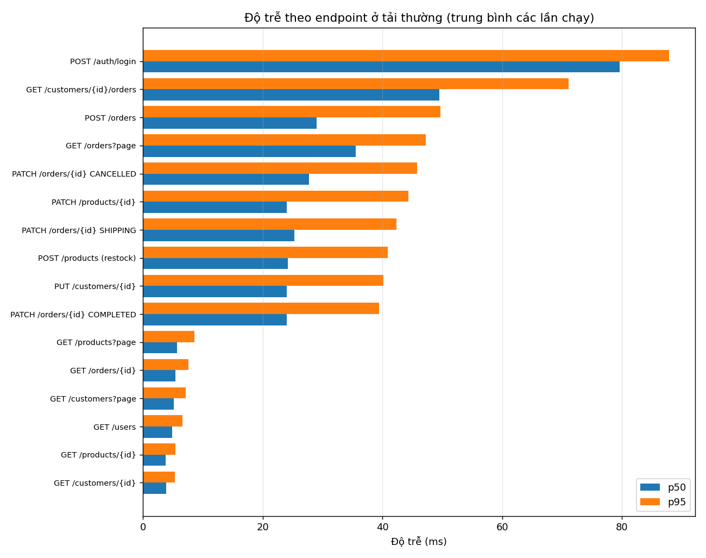
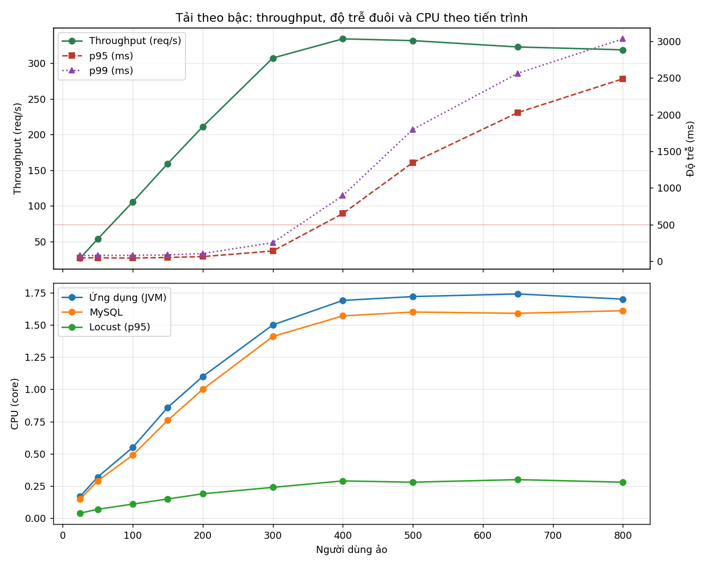
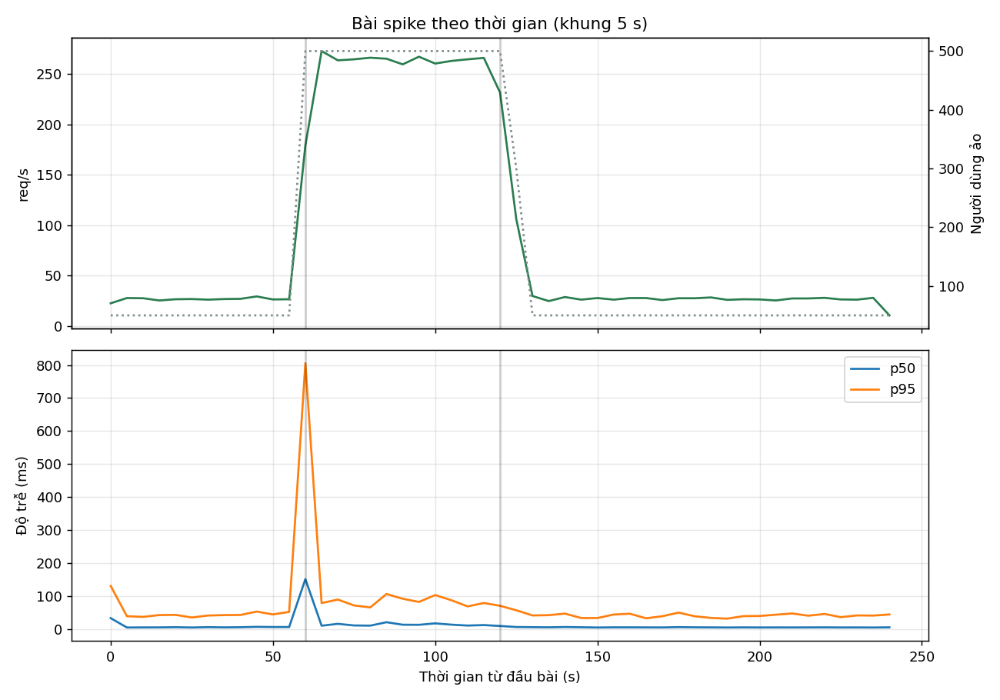

# Báo cáo hoàn thành kiểm thử tải: `phase1`

| Thông tin | Giá trị |
| :--- | :--- |
| Loại tài liệu | Báo cáo hoàn thành kiểm thử (test completion report) |
| Kế hoạch kiểm thử | `docs/load-testing.md` |
| Phiên bản được kiểm thử | `phase1`, commit `808b8634c7832932fc06b495b21c0094d3939cfe` |
| Thời điểm chạy | 2026-10-29T15:51:54+0000 |

## 1. Tóm tắt

| Bài | Tiêu chí | Kết quả | Đánh giá |
| :--- | :--- | :--- | :--- |
| smoke | Không lỗi, tồn kho cân bằng | 208 request, lỗi 0.0% | Đạt |
| load | p95 ≤ 500 ms, p99 ≤ 1000 ms, lỗi ≤ 1.0% ở mọi lần chạy | p95 48.13 ± 4.6 ms, 53.53 req/s | Đạt |
| breakpoint | Xác định được năng lực tối đa trong SLO | 307.4 req/s tại 300 người dùng ảo | Đạt |
| spike | Không lỗi trong lúc sốc tải và hồi phục được | lỗi 0.0%, hồi phục sau 10.0 s | Đạt |
| flashsale | Bán vượt = 0, số đơn client nhận khớp CSDL | bán 500/500, bán vượt 0 | Đạt |
| Mọi bài | Tồn kho cân bằng, không âm kho, tổng tiền đơn đúng | 8/8 bài cân bằng | Đạt |

## 2. Môi trường kiểm thử

| Thành phần | Cấu hình |
| :--- | :--- |
| CPU | AMD EPYC 7B12, 4 core logic |
| RAM | 31.3 GB |
| Phân bổ CPU | ứng dụng và MySQL: core 0-2; Locust: core 3 |
| Java | openjdk version "21.0.12.1" 2026-08-18; `-Xms1g -Xmx1g -XX:+UseG1GC` |
| MySQL | MySQL 8.0.46-0ubuntu0.24.04.4 |
| Locust | locust 2.47.0 |
| Python | 3.13.15 |

## 3. Kết quả theo bài kiểm thử

Tiêu chí hiệu năng: p95 ≤ 500 ms, p99 ≤ 1000 ms, tỉ lệ lỗi ≤ 1.0%.

### 3.1. Smoke

Bài smoke gửi 208 request với tỉ lệ lỗi 0.0%. Tồn kho sau bài: cân bằng.

### 3.2. Tải thường

Bài tải thường chạy 3 lần. Throughput trung bình là 53.53 req/s và p95 trung bình là 48.13 ms.

| Bài | Số request | Throughput (req/s) | p50 (ms) | p95 (ms) | p99 (ms) | Lỗi (%) | CPU ứng dụng (core) | CPU MySQL (core) | CPU Locust p95 (core) | Lệch so với định luật Little (%) | Đạt SLO | Tồn kho cân bằng |
| :--- | :--- | :--- | :--- | :--- | :--- | :--- | :--- | :--- | :--- | :--- | :--- | :--- |
| load_r1 | 8135 | 53.7 | 6.0 | 46.6 | 79.2 | 0.0 | 0.39 | 0.3 | 0.07 | 8.3 | Có | Có |
| load_r2 | 8061 | 53.2 | 6.2 | 53.3 | 81.1 | 0.0 | 0.33 | 0.32 | 0.07 | 7.3 | Có | Có |
| load_r3 | 8142 | 53.7 | 5.7 | 44.5 | 78.6 | 0.0 | 0.3 | 0.29 | 0.07 | 8.2 | Có | Có |

**Độ dao động giữa các lần chạy**

| Chỉ số | Trung bình | Độ lệch chuẩn | Hệ số biến thiên (%) |
| :--- | :--- | :--- | :--- |
| Throughput (req/s) | 53.53 | 0.29 | 0.5 |
| p50 (ms) | 5.97 | 0.25 | 4.2 |
| p95 (ms) | 48.13 | 4.6 | 9.5 |
| p99 (ms) | 79.63 | 1.31 | 1.6 |
| Lỗi (%) | 0.0 | 0.0 | 0.0 |
| CPU ứng dụng (core) | 0.34 | 0.05 | 13.5 |
| CPU MySQL (core) | 0.3 | 0.02 | 5.0 |

**Độ trễ theo endpoint** (trung bình các lần chạy)

| Endpoint | Số request | p50 (ms) | p95 (ms) | p99 (ms) | Số lỗi |
| :--- | :--- | :--- | :--- | :--- | :--- |
| GET /products?page | 5758 | 5.7 | 8.6 | 12.1 | 0 |
| GET /products/{id} | 5048 | 3.8 | 5.4 | 6.4 | 0 |
| GET /orders?page | 2472 | 35.5 | 47.2 | 53.7 | 0 |
| POST /orders | 2382 | 29.0 | 49.7 | 68.4 | 0 |
| GET /orders/{id} | 1966 | 5.4 | 7.6 | 8.9 | 0 |
| GET /customers/{id} | 1879 | 3.9 | 5.3 | 6.2 | 0 |
| PATCH /orders/{id} SHIPPING | 1020 | 25.3 | 42.3 | 57.4 | 0 |
| GET /customers/{id}/orders | 967 | 49.5 | 71.1 | 85.0 | 0 |
| POST /products (restock) | 560 | 24.2 | 40.9 | 62.6 | 0 |
| GET /customers?page | 499 | 5.1 | 7.1 | 7.6 | 0 |
| PATCH /products/{id} | 464 | 24.0 | 44.3 | 59.8 | 0 |
| POST /auth/login | 362 | 79.6 | 87.9 | 95.3 | 0 |
| PUT /customers/{id} | 303 | 24.0 | 40.2 | 57.8 | 0 |
| PATCH /orders/{id} COMPLETED | 250 | 24.0 | 39.4 | 47.6 | 0 |
| GET /users | 209 | 4.9 | 6.6 | 11.1 | 0 |
| PATCH /orders/{id} CANCELLED | 199 | 27.7 | 45.8 | 56.0 | 0 |

### 3.3. Breakpoint

Năng lực tối đa trong SLO là 307.4 req/s tại 300 người dùng ảo. CPU cấp cho ứng dụng và MySQL đã dùng hết ở bậc cuối; phân chia: ứng dụng 51% / MySQL 49%.

| Người dùng ảo | Số request | Throughput (req/s) | p50 (ms) | p95 (ms) | p99 (ms) | Lỗi (%) | CPU ứng dụng (core) | CPU MySQL (core) | CPU Locust p95 (core) | Chờ khóa dòng TB (ms) | Đạt SLO |
| :--- | :--- | :--- | :--- | :--- | :--- | :--- | :--- | :--- | :--- | :--- | :--- |
| 25 | 1340 | 26.8 | 5.7 | 45.9 | 78.5 | 0.0 | 0.17 | 0.15 | 0.04 | - | Có |
| 50 | 2671 | 53.4 | 5.7 | 46.3 | 79.2 | 0.0 | 0.32 | 0.29 | 0.07 | - | Có |
| 100 | 5267 | 105.4 | 5.5 | 43.7 | 80.6 | 0.0 | 0.55 | 0.49 | 0.11 | 11.3 | Có |
| 150 | 7962 | 159.3 | 6.2 | 50.8 | 85.3 | 0.0 | 0.86 | 0.76 | 0.15 | 16.9 | Có |
| 200 | 10554 | 211.1 | 8.2 | 63.0 | 105.0 | 0.0 | 1.1 | 1.0 | 0.19 | 13.5 | Có |
| 300 | 15367 | 307.4 | 25.8 | 139.2 | 253.1 | 0.0 | 1.5 | 1.41 | 0.24 | 13.8 | Có |
| 400 | 16712 | 334.3 | 224.6 | 650.0 | 895.5 | 0.0 | 1.69 | 1.57 | 0.29 | 13.5 | Không |
| 500 | 16587 | 331.8 | 516.8 | 1346.5 | 1798.6 | 0.0 | 1.72 | 1.6 | 0.28 | 13.5 | Không |
| 650 | 16144 | 322.9 | 1026.2 | 2028.5 | 2564.4 | 0.0 | 1.74 | 1.59 | 0.3 | 14.4 | Không |
| 800 | 15939 | 318.9 | 1497.0 | 2489.0 | 3033.9 | 0.0 | 1.7 | 1.61 | 0.28 | 10.9 | Không |

| Chỉ số | Giá trị |
| :--- | :--- |
| Năng lực tối đa trong SLO | 307.4 req/s |
| Số người dùng ảo tại năng lực tối đa | 300 |
| Bậc đầu tiên vi phạm SLO | 400 |
| Bậc throughput ngừng tăng tương xứng | 400 |
| Số core cấp cho ứng dụng và MySQL | 3 |
| Tỉ lệ dùng số core đó ở bậc cuối | 1.1 |
| Phân chia CPU ở bậc cuối | ứng dụng 51% / MySQL 49% |

### 3.4. Spike

Khi tải tăng đột ngột, p95 tăng từ 43.1 ms lên 115.9 ms, tỉ lệ lỗi 0.0%. Sau khi tải giảm, p95 về lại mức nền sau 10.0 s.

| p95 nền (ms) | p95 khi sốc tải (ms) | p99 khi sốc tải (ms) | Lỗi khi sốc tải (%) | Thời gian hồi phục (s) |
| :--- | :--- | :--- | :--- | :--- |
| 43.1 | 115.9 | 592.7 | 0.0 | 10.0 |

### 3.5. Flash sale

500 đơn được tạo và 36590 request bị từ chối do hết hàng. Số bán vượt là 0.

| Tồn kho ban đầu | Đơn tạo thành công (201) | Từ chối hết hàng (400) | Đã bán trong CSDL | Tồn kho sau | Bán vượt | Client khớp CSDL | p95 (ms) | p99 (ms) | Số lần chờ khóa dòng | Chờ khóa dòng TB (ms) | Deadlock |
| :--- | :--- | :--- | :--- | :--- | :--- | :--- | :--- | :--- | :--- | :--- | :--- |
| 500 | 500 | 36590 | 500 | 0 | 0 | Có | 405.9 | 2074.9 | 36698 | 7.6 | 0 |

## 4. Đúng đắn dữ liệu

Bảng sau là kết quả đối soát tồn kho sau từng bài kiểm thử.

| Bài | Cân bằng | Sản phẩm lệch | Sản phẩm âm kho | Đơn sai tổng tiền | Đã bán | Nhập thêm | Hoàn kho | Đơn mới theo trạng thái |
| :--- | :--- | :--- | :--- | :--- | :--- | :--- | :--- | :--- |
| smoke | Có | 0 | 0 | 0 | 115 | 71 | 0 | {"CANCELLED": 3, "PENDING": 24, "SHIPPING": 2, "COMPLETED": 1} |
| warmup | Có | 0 | 0 | 0 | 1019 | 1479 | 0 | {"SHIPPING": 65, "PENDING": 143, "COMPLETED": 43, "CANCELLED": 31} |
| load_r1 | Có | 0 | 0 | 0 | 3423 | 5658 | 0 | {"SHIPPING": 281, "COMPLETED": 94, "PENDING": 482, "CANCELLED": 78} |
| load_r2 | Có | 0 | 0 | 0 | 3491 | 6104 | 0 | {"PENDING": 507, "COMPLETED": 101, "CANCELLED": 76, "SHIPPING": 260} |
| load_r3 | Có | 0 | 0 | 0 | 3228 | 7057 | 8 | {"SHIPPING": 265, "COMPLETED": 95, "PENDING": 456, "CANCELLED": 83} |
| breakpoint | Có | 0 | 0 | 0 | 47609 | 73019 | 0 | {"PENDING": 7171, "SHIPPING": 4062, "COMPLETED": 577, "CANCELLED": 1087} |
| spike | Có | 0 | 0 | 0 | 7758 | 13106 | 0 | {"PENDING": 1106, "COMPLETED": 186, "SHIPPING": 645, "CANCELLED": 170} |
| flashsale | Có | 0 | 0 | 0 | 500 | 0 | 0 | {"PENDING": 500} |

## 5. Sai khác so với kế hoạch

Không có.

## 6. Cảnh báo về tính hợp lệ của phép đo

Không có. Bộ sinh tải không bị nghẽn CPU ở bài nào.
