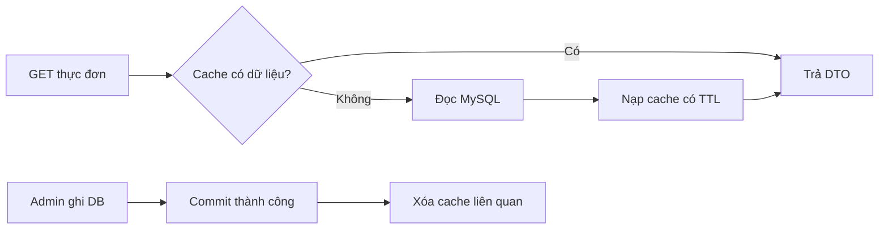
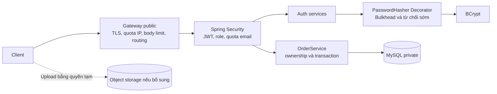

# Báo cáo nghiên cứu design pattern cho backend ByteMe

Ngày nghiên cứu: 23/11/2026. Phạm vi: backend Java trong `src/main`, schema MySQL, cấu hình triển khai và các kiểm thử liên quan trong thư mục hiện tại.

ByteMe là backend đặt món cho một nhà hàng, tổ chức theo tầng Controller → Service → Repository, chạy Spring Boot 3.5.16, Java 21 và MySQL 8.4. Hướng cải tiến phù hợp là củng cố tính đúng đắn của transaction, tối ưu đường đọc thực đơn và giới hạn tài nguyên xác thực trước khi bổ sung kiến trúc phân tán.

**Đề xuất chính:** Pessimistic Locking + Lock Ordering + transaction cho đặt hàng; Cache-Aside + TTL + evict sau commit cho thực đơn; Bulkhead + Load Shedding được cài bằng Decorator quanh `PasswordHasher` cho xác thực; bổ sung gateway khi triển khai công khai. Optimistic Locking và Atomic Conditional Update là các phương án đối chiếu, cần benchmark riêng. Queue, CQRS với kho đọc riêng, Index Table và Sidecar chưa phải lựa chọn ưu tiên cho quy mô hiện tại.

Đây là báo cáo phân tích và thiết kế đề xuất; các ví dụ dưới đây chưa được áp dụng vào backend. Các mục ghi “slide” được đối chiếu với tài liệu kiến trúc công khai; chưa có nội dung slide môn học để đối chiếu thuật ngữ riêng của giảng viên.

## 1. Cách đánh giá và bằng chứng trong backend

### 1.1. Phân biệt các nhóm mẫu

Danh sách nghiên cứu gồm nhiều cấp độ. Decorator là mẫu cấu trúc GoF; Unit of Work là mẫu tổ chức truy cập dữ liệu; locking và conditional update là kỹ thuật kiểm soát đồng thời; TTL/evict là chính sách nhất quán cache; Bulkhead, Gatekeeper và gateway là các mẫu khả năng phục hồi hoặc kiến trúc. Việc gọi chung là “design pattern” hữu ích khi trình bày, nhưng triển khai và đánh giá phải theo đúng cấp độ.

Độ phức tạp được xét ở hai phương diện:

- **Triển khai và vận hành:** thấp, trung bình, cao; xét thay đổi schema, đồng bộ dữ liệu, tài nguyên mới, xử lý lỗi và kiểm thử.
- **Chi phí thực thi:** số truy vấn, thời gian chờ, CPU, bộ nhớ và chi phí truyền dữ liệu. Big-O chỉ mô tả mô hình gần đúng, không thay thế benchmark.

Ký hiệu: `N` là số món trong DB; `k` là số món khác nhau trong một giỏ; `m` là số kết quả trả về; `E` là số cache entry; `b` là giới hạn BCrypt chạy đồng thời; `Q` là độ dài hàng đợi; `r` là số lần thử transaction. Chi phí tìm một khóa B-tree thường được mô hình hóa là `O(log N)`; thời gian chờ khóa không bị chặn bởi biểu thức này. Mọi endpoint trả `m` món vẫn có ít nhất chi phí xử lý/truyền `O(m)`.

### 1.2. Hiện trạng đã đối chiếu từ mã nguồn

Các đường dẫn trong bảng là bằng chứng nội bộ, tính từ thư mục gốc repo.

| Khu vực | Bằng chứng | Ý nghĩa đối với lựa chọn mẫu |
| --- | --- | --- |
| Nền tảng | [`pom.xml`](../pom.xml), [`compose.yaml`](../compose.yaml) | Có JPA, Security, Actuator, Testcontainers; chưa khai báo cache provider, Redis, Resilience4j hoặc gateway trong các file này. Compose gồm MySQL và backend. |
| Trừ và hoàn kho | [`FoodService.java`](../src/main/java/org/example/service/FoodService.java), `reserveStock`, `releaseStock` | Đọc bằng `findById`, kiểm tra rồi sửa entity; chưa có khóa tường minh hay conditional update. `updateFood` cũng có thể đặt lại tồn kho. |
| Checkout | [`OrderService.java`](../src/main/java/org/example/service/OrderService.java), `create` | Có `@Transactional`, lấy giỏ, trừ kho từng món, lưu đơn rồi xóa giỏ. Thứ tự duyệt hiện đi theo map giỏ, chưa quy định tăng dần `foodId`. |
| Giỏ hàng | [`CartService.java`](../src/main/java/org/example/service/CartService.java), [`CartRepository.java`](../src/main/java/org/example/repository/CartRepository.java) | Giỏ được tìm bằng `findByUserId`; chưa khóa để phối hợp checkout với thêm/sửa/xóa. `saveChanges` dùng `saveAndFlush`, có thể flush các thay đổi đang chờ trong persistence context. |
| Hủy và cập nhật đơn | `OrderService.cancel`, `updateStatus`, `moveTo` | Đọc đơn không khóa; chuyển `CANCELLED` gọi hoàn kho. Cần bảo vệ cả trạng thái đơn lẫn số lượng tồn. |
| Entity và schema | [`Food.java`](../src/main/java/org/example/entity/Food.java), [`schema.sql`](../src/main/resources/db/schema.sql) | Chưa có cột `version`. Có PK, UNIQUE và FK; chưa khai báo composite index riêng cho lọc thực đơn; chưa có CHECK tồn kho không âm. InnoDB có thể tự tạo index hỗ trợ FK, vì vậy không được nói DB “không có index”. |
| Đọc thực đơn | [`FoodRepository.java`](../src/main/java/org/example/repository/FoodRepository.java), `findActive`, `searchActive` | Lọc ACTIVE, tùy chọn category, sắp xếp ID; tìm kiếm `lower(...) LIKE '%keyword%'` trên tên hoặc mô tả; trả danh sách chưa phân trang. |
| Dữ liệu cache tiềm năng | [`FoodDto.java`](../src/main/java/org/example/dto/FoodDto.java) | DTO gồm cả tên, giá, trạng thái và `stockQuantity`; cache toàn DTO sẽ cache cả dữ liệu tồn kho thay đổi thường xuyên. |
| Xác thực | [`LoginService.java`](../src/main/java/org/example/service/LoginService.java), [`RegisterService.java`](../src/main/java/org/example/service/RegisterService.java) | Login gọi `matches`, kể cả email không tồn tại bằng dummy hash; register gọi `hash`. Login tạo dummy hash một lần trong constructor. |
| Bộ băm | [`PasswordHasher.java`](../src/main/java/org/example/service/PasswordHasher.java), [`BCryptPasswordHasher.java`](../src/main/java/org/example/platform/security/BCryptPasswordHasher.java), [`AdapterConfiguration.java`](../src/main/java/org/example/platform/config/AdapterConfiguration.java) | Có interface và bean tập trung, thuận lợi bọc Decorator mà giữ nguyên hai service. |
| Giới hạn đăng nhập | [`LoginIpFilter.java`](../src/main/java/org/example/platform/security/LoginIpFilter.java), [`LoginRateLimiter.java`](../src/main/java/org/example/platform/security/LoginRateLimiter.java), [`AuthController.java`](../src/main/java/org/example/controller/AuthController.java) | Filter chặn IP trước controller cho POST token; controller chặn email trước login. Fixed window trong bộ nhớ, phương thức cập nhật `synchronized`, có cleanup và chặn khi map đạt 100.000 khóa. Register chưa qua hai bộ đếm này. |
| Cấu hình quota | [`application.yml`](../src/main/resources/application.yml) | Mặc định 10/email và 100/IP trong 900 giây; đây là giá trị cấu hình, không phải kết quả đo sức chịu tải. |
| Bảo vệ API | [`SecurityConfiguration.java`](../src/main/java/org/example/config/SecurityConfiguration.java), [`CurrentUser.java`](../src/main/java/org/example/common/CurrentUser.java) | Đã có JWT, phân quyền endpoint và lấy danh tính từ token; quyền sở hữu đơn còn được kiểm tra trong service. |
| Lỗi tranh chấp | [`GlobalErrors.java`](../src/main/java/org/example/common/GlobalErrors.java) | Có ánh xạ `PessimisticLockingFailureException` sang 409 `CONCURRENT_UPDATE`; tên exception không chứng minh đã triển khai pessimistic locking. |
| Ranh giới tầng | [`ArchitectureTest.java`](../src/test/java/org/example/ArchitectureTest.java) | Service không được phụ thuộc Web/HTTP, JPA, Spring Data, JDBC; SQL/lock/flush đặt ở repository, HTTP 429/503 đặt ở web adapter. |

### 1.3. Kết quả tải cũ và giới hạn suy luận

[`kaggle/results/phase1-baseline/README.md`](../kaggle/results/phase1-baseline/README.md) ghi lần chạy 26/10/2026 từ commit `ed8be73`: 18.029 request, lỗi 0%, P95 8,56 giây, P99 10,02 giây, khoảng 99 RPS trung bình. Kịch bản trộn thực đơn, tìm kiếm, giỏ và login. Cấu hình Hikari 50/Tomcat 200 của lần chạy đó không được suy thành cấu hình runtime hiện tại.

Số liệu cho thấy mục tiêu latency của lần chạy không đạt, nhưng chưa chứng minh BCrypt là nguyên nhân chính. Cần đo CPU/profile, thời gian BCrypt, truy vấn, Hikari pending và Tomcat busy theo từng endpoint. Báo cáo không suy ra mức tăng tốc hay số permit từ số liệu tổng hợp cũ.

## 2. Việc 1 Đặt hàng đúng khi đông người

### 2.1. Vấn đề cần bảo đảm

Transaction bảo đảm một lần checkout thành công hoặc rollback toàn bộ; nó chưa tự ngăn hai transaction đọc cùng tồn kho rồi ghi đè nhau. Ví dụ tồn 5, hai giỏ cùng mua 4: cả hai có thể đọc 5 và đặt stock thành 1. Tổng bán 8 dù tồn cuối vẫn không âm. CHECK `stock_quantity >= 0` không phát hiện được lost update này.

Các bất biến cần bảo vệ gồm: tổng lượng đặt không vượt kho; một lần hủy chỉ hoàn kho một lần; giỏ không bị checkout hai lần; cập nhật giỏ không mất trong lúc checkout; admin sửa tồn không ghi đè thay đổi của checkout; tên/giá trong đơn là snapshot nhất quán tại thời điểm chốt.

### 2.2. Pessimistic Locking

**Tác dụng và nguyên lý.** Lấy khóa ghi trước khi đọc và quyết định cập nhật. `SELECT ... FOR UPDATE` trong transaction InnoDB giữ khóa đến commit/rollback; transaction khác muốn sửa cùng hàng phải đợi hoặc thất bại theo timeout. Khóa vào PK giúp thu hẹp phạm vi; locking read theo range có thể khóa nhiều bản ghi/khoảng hơn. Đọc thường theo MVCC không đồng nghĩa luôn bị khóa ghi chặn. [MySQL Locking Reads](https://dev.mysql.com/doc/refman/8.4/en/innodb-locking-reads.html).

Ví dụ SQL minh họa cho một món, không phải script triển khai:

```sql
START TRANSACTION;
SELECT id, name, price, status, stock_quantity
FROM foods WHERE id = :food_id FOR UPDATE;
-- Kiểm tra quantity > 0, ACTIVE, đủ kho rồi mới cập nhật.
UPDATE foods
SET stock_quantity = stock_quantity - :qty
WHERE id = :food_id;
-- Lưu đơn và xóa giỏ trong cùng transaction.
COMMIT;
```

**Áp dụng vào ByteMe.** Thêm method repository dùng `@Lock(PESSIMISTIC_WRITE)` hoặc SQL tương đương cho Food, Cart và Order. Service chỉ gọi method nghiệp vụ của repository. Các đường `reserveStock`, `releaseStock`, `updateFood`, ngừng bán phải dùng cùng giao thức; khóa riêng checkout sẽ để lại lỗi ở hoàn kho hoặc admin cập nhật entity cũ.

Checkout khóa giỏ trước khi đọc item; tất cả thao tác thay đổi giỏ cũng khóa hàng giỏ trước. Khi chưa có giỏ, không được giả định truy vấn không tìm thấy sẽ tạo được mutex ổn định: dùng hàng user tồn tại để phối hợp khởi tạo hoặc dựa UNIQUE và xử lý retry ở transaction mới. Khi hủy/xác nhận/chuyển trạng thái, khóa hàng order trước khi kiểm tra trạng thái. Hủy sau đó khóa Food theo ID tăng dần và hoàn kho.

**Độ phức tạp.** Triển khai trung bình, không cần dịch vụ ngoài. Với `k` món có khoảng `k` lần tìm/khóa và cập nhật, chi phí tra cứu gần `O(k log N)`; thời gian chờ tăng mạnh nếu nhiều khách mua cùng món. Có thêm áp lực connection pool vì transaction chờ vẫn giữ connection. Không gọi HTTP ngoài, băm mật khẩu hay chờ người dùng trong transaction này.

**Độ phù hợp: rất cao.** Đường đọc tên/giá và sửa kho hiện nằm trong JPA, nên khóa trước khi đọc là thay đổi dễ giải thích và kiểm chứng. Hạn chế lớn là tuần tự hóa món bán chạy; cần timeout, metric chờ khóa và retry có giới hạn.

### 2.3. Optimistic Locking

**Tác dụng và nguyên lý.** Thêm `@Version` vào entity và cột version trong DB. Khi cập nhật, ORM kiểm tra version đã đọc; nếu version đổi thì từ chối ghi để tránh lost update. Đây là phát hiện xung đột, không phải đặt chỗ tồn kho ngay khi đọc. Đặc tả cũng nêu kiểm tra có thể xảy ra lúc flush/commit. [Jakarta Persistence, phần Version Attributes và Optimistic Locking](https://jakarta.ee/specifications/persistence/3.1/jakarta-persistence-spec-3.1).

```sql
-- Mô hình SQL của kiểm tra version, không phải câu lệnh JPA nguyên văn.
UPDATE foods
SET stock_quantity = :new_stock, version = version + 1
WHERE id = :id AND version = :old_version;
-- 0 hàng cập nhật: dữ liệu đã thay đổi hoặc hàng không còn tồn tại.
```

**Áp dụng vào ByteMe.** Bổ sung version cho Food; cân nhắc Order để ngăn hai lần chuyển trạng thái cùng thắng. Version của Cart cha không tự bảo đảm thay đổi CartItem con sẽ tăng version cha: cần chiến lược tăng version cha hoặc khóa giỏ được thiết kế rõ. Bulk JPQL/native SQL có thể bỏ qua cơ chế version của ORM; mọi đường cập nhật phải tuân thủ cùng quy tắc.

**Độ phức tạp.** Trung bình về schema và mapping, cao hơn khi thêm retry. Không chờ khóa tường minh ở bước đọc nhưng UPDATE vẫn dùng khóa DB. Nếu thất bại nhiều, chi phí thực tế gần `O(r × k log N)` và làm lại toàn bộ nghiệp vụ. Retry từ ngoài transaction đã thất bại; không tiếp tục dùng persistence context rollback-only. Cần handler chuyển lỗi optimistic thành phản hồi xung đột có kiểm soát.

**Độ phù hợp: cao để thử nghiệm thay thế.** Hợp khi xung đột hiếm, ví dụ quản trị món. Với một số món rất nóng, nhiều transaction cùng thua và làm lại nên có thể kém hơn khóa bi quan. Không bật cả hai cơ chế trên mọi đường chỉ để “an toàn hơn” khi chưa có mục tiêu và số đo.

### 2.4. Atomic Conditional Update

**Tác dụng và nguyên lý.** Gộp kiểm tra điều kiện và trừ kho trong một câu UPDATE; ứng dụng kiểm tra số hàng bị ảnh hưởng. Phép tính dùng giá trị DB tại lúc thực hiện thay vì số đã đọc trước đó. Đây vẫn là cập nhật có khóa của InnoDB, không phải thuật toán lock-free. [MySQL UPDATE](https://dev.mysql.com/doc/refman/8.4/en/update.html).

```sql
UPDATE foods
SET stock_quantity = stock_quantity - :qty
WHERE id = :food_id
  AND status = 'ACTIVE'
  AND stock_quantity >= :qty;
```

**Áp dụng vào ByteMe.** Xác thực `qty > 0` trước câu SQL. Kết quả 1 hàng cho phép đi tiếp, 0 hàng là không đặt được; bản thân con số 0 chưa phân biệt không tồn tại, ngừng bán và thiếu kho. Nếu đọc thêm để phân loại lỗi, trạng thái có thể đã thay đổi; cần hợp đồng lỗi chấp nhận điều đó hoặc quy trình khóa chặt hơn.

Backend còn cần snapshot tên/giá: MySQL 8.4 không có `UPDATE ... RETURNING` để trả ngay toàn bộ Food như một số DB khác. Một hướng là UPDATE trước, sau đó đọc hiện hành/locking read trong cùng transaction khi đã giữ khóa ghi. Không dùng Food đã nạp cũ trong persistence context làm snapshot. Bulk update bỏ qua trạng thái entity đang được quản lý; repository phải thiết kế flush/refresh/clear phù hợp, tránh clear làm mất thay đổi chưa flush của order/cart.

Hoàn kho dùng phép cộng tại DB, nhưng **chỉ sau khi giành được quyền chuyển đơn sang CANCELLED** bằng lock hoặc compare-and-set trạng thái. Phép cộng nguyên tử riêng lẻ vẫn cộng hai lần nếu hai request cùng hủy. Admin đặt tồn kho tuyệt đối cũng phải phối hợp, không để dirty checking ghi đè tồn mới.

**Độ phức tạp.** SQL ngắn, tích hợp trung bình đến cao do JPA và snapshot. Mỗi món cần một lệnh trừ kho; toàn checkout vẫn gồm nhiều lệnh và phải ở chung transaction để món thứ hai thất bại thì món thứ nhất rollback. Chi phí tra cứu gần `O(k log N)`; vẫn chờ khóa khi tranh chấp cùng hàng.

**Độ phù hợp: cao cho tối ưu đường kho sau khi đo.** Có thể giảm bước đọc để kiểm tra kho, nhưng không mặc định giảm toàn checkout xuống một câu SQL. Không được trộn conditional update với các đường read-modify-write cũ thiếu phối hợp.

### 2.5. Lock Ordering

**Tác dụng và nguyên lý.** Các transaction lấy nhiều khóa theo cùng thứ tự để giảm vòng chờ. Hai giỏ chứa món A/B theo thứ tự ngược nhau là tình huống điển hình. MySQL khuyến nghị giữ transaction ngắn, thứ tự truy cập nhất quán và vẫn chuẩn bị retry khi deadlock. [MySQL Deadlock Handling](https://dev.mysql.com/doc/refman/8.4/en/innodb-deadlocks-handling.html).

**Áp dụng vào ByteMe.** Sắp xếp ID món trước khi lấy khóa; hủy đơn cũng dùng cùng thứ tự. Quy ước đề xuất khi có nhiều loại tài nguyên là Idempotency → User nếu cần khởi tạo → Cart → Order đã tồn tại → Food tăng dần; mỗi luồng chỉ lấy phần cần thiết và không lấy ngược trở lại. Insert order mới sau khi khóa Food cần được đánh giá riêng với FK và SQL thực tế.

Không chỉ sort `cart.forEach`: phải lấy khóa X của các Food cần sửa **trước** bước insert `order_items` có FK, để giảm tình huống hai transaction cùng giữ khóa S do FK rồi cùng nâng lên X. Một truy vấn `IN (...) ORDER BY id` không tự chứng minh thứ tự lấy khóa vật lý trong mọi execution plan; nếu cần kiểm soát rõ, khóa từng PK tăng dần và kiểm tra SQL/plan.

**Độ phức tạp.** Thấp về thuật toán: sort `O(k log k)`, lưu danh sách `O(k)`. Trung bình về triển khai vì mọi luồng phải tuân thủ. Vẫn có deadlock từ index, FK, flush và luồng chưa kiểm soát; đặt retry hữu hạn ngoài transaction, có backoff/jitter.

**Độ phù hợp: bắt buộc đi kèm phương án nhiều hàng.** Áp dụng cả khi dùng conditional update vì UPDATE cũng lấy khóa. Lock ordering bổ trợ locking, không thay thế bảo vệ lost update.

### 2.6. Unit of Work và Transaction

**Tác dụng và nguyên lý.** Unit of Work theo dõi các đối tượng thay đổi để tổ chức ghi dữ liệu; transaction cung cấp ranh giới commit/rollback. Hai khái niệm liên quan nhưng khác nhau. JPA persistence context/dirty checking thực hiện phần lớn Unit of Work; `@Transactional` bao quanh đơn vị nghiệp vụ. [Martin Fowler, Unit of Work](https://martinfowler.com/eaaCatalog/unitOfWork.html).

**Hiện trạng ByteMe.** `OrderService.create` gọi các bean CartService/FoodService có transaction mặc định REQUIRED, cùng tham gia transaction ngoài. Trừ kho, insert đơn và xóa item giỏ được chốt cùng nhau. `saveAndFlush` đẩy SQL xuống DB nhưng chưa phải commit. Các integration test hiện có đã mô tả rollback checkout và hủy đơn, nhưng không thay thế kiểm thử đồng thời.

**Ràng buộc.** Proxy Spring mặc định không áp dụng advice cho self-invocation. `confirm` có annotation ở điểm vào nên gọi nội bộ `updateStatus` vẫn nằm trong transaction đó, không tạo transaction mới. Mặc định rollback cho RuntimeException/Error; checked exception cần cấu hình nếu nghiệp vụ yêu cầu. Không chuyển trừ kho sang `REQUIRES_NEW`, vì sẽ phá tính nguyên tử checkout. [Spring Transactional](https://docs.spring.io/spring-framework/reference/6.2/data-access/transaction/declarative/annotations.html).

**Độ phức tạp và phù hợp.** Chi phí bổ sung thấp vì đã có; chi phí runtime theo số entity cần theo dõi/flush và số ghi DB. Cần giữ lại, phối hợp với một cơ chế concurrency. Transaction không thay thế lock, version, hay idempotency.

### 2.7. Idempotency Key

**Tác dụng và nguyên lý.** Client tạo một mã cho một ý định đặt hàng và dùng lại mã đó khi retry. Server nhận diện theo danh tính caller và mã, tránh tác dụng phụ lặp lại, đồng thời trả kết quả tương đương. Việc ghi nhận mã và thay đổi nghiệp vụ phải nguyên tử. [AWS Builders’ Library, Idempotent APIs](https://aws.amazon.com/builders-library/making-retries-safe-with-idempotent-APIs/).

**Thiết kế đề xuất cho ByteMe.** Thêm bảng có UNIQUE `(user_id, operation, idempotency_key)`, dấu vân tay request đã chuẩn hóa, `order_id`, thời gian hết hạn và dữ liệu phản hồi cần lưu. Key do client sinh, có giới hạn độ dài. Header được controller chuyển vào command; service không đọc `HttpServletRequest`.

Luồng xử lý:

1. Kiểm tra quyền và dữ liệu, tra/đăng ký key trước khi đọc giỏ.
2. Nếu key đã hoàn thành và fingerprint khớp, trả lại đơn/kết quả đã lưu; không đọc giỏ hiện tại vì giỏ có thể đã rỗng hoặc chứa món mới.
3. Nếu key trùng nhưng nội dung khác, trả 409 theo hợp đồng đề xuất; không âm thầm xử lý ý định mới.
4. Nếu request đầu đang chạy, request sau chờ có giới hạn hoặc nhận trạng thái xung đột đang xử lý. UNIQUE trong DB là hàng rào cuối; không dựa vào `if exists` trong bộ nhớ.
5. Ghi key, tạo order, trừ kho, xóa giỏ và liên kết kết quả trong cùng transaction. Nếu thua UNIQUE hoặc transaction thất bại, rollback rồi đọc lại bằng transaction mới, không cố cứu transaction đã hỏng.

Request hiện không chứa item mà dùng giỏ mutable. Fingerprint nên gồm body đặt hàng và, khi bổ sung hợp đồng mới, cart revision tại lúc xác nhận. Hai lần đặt giống body nhưng có chủ đích khác phải dùng hai key khác nhau. Không tính fingerprint từ giỏ hiện tại mỗi lần retry, vì nó đã thay đổi sau lần đầu.

**Độ phức tạp.** Trung bình đến cao: thêm schema, migration, xử lý đang chạy, lưu/replay phản hồi và cleanup. Tìm key gần `O(log I)` với `I` bản ghi; bộ nhớ/lưu trữ tăng theo số key trong thời hạn giữ. Thời hạn phải bao phủ cửa sổ retry; hết hạn rồi gửi lại có thể trở thành ý định mới.

**Độ phù hợp: cao.** Hữu ích cho double-click và timeout mạng. Không thay thế khóa giỏ: hai key khác nhau vẫn có thể cùng checkout một giỏ. Chỉ cam kết không lặp tác dụng phụ trong phạm vi key và thời hạn đã định, không tuyên bố “exactly once” vô điều kiện.

### 2.8. So sánh lựa chọn cho đặt hàng

| Phương án | Cách xử lý tranh chấp | Chi phí chính | Lựa chọn cho ByteMe |
| --- | --- | --- | --- |
| Pessimistic | Chờ khóa trước khi quyết định | Connection chờ, transaction cần ngắn | Ưu tiên để sửa tính đúng đắn và giữ snapshot dễ hiểu |
| Optimistic | Phát hiện version cũ khi ghi | Rollback/retry khi món nóng | Nhánh thí nghiệm thay thế; tốt hơn khi ít xung đột |
| Conditional update | Điều kiện và phép trừ cùng lệnh | Khóa DB, đồng bộ JPA và đọc snapshot | Nhánh tối ưu sau khi có kiểm thử bất biến |
| Lock Ordering | Giảm vòng chờ nhiều khóa | Sort và tuân thủ toàn bộ luồng | Dùng với cả ba hướng khi có nhiều món |
| Unit of Work/Transaction | Commit/rollback toàn nghiệp vụ | Theo dõi entity, connection, flush | Giữ nền tảng đang có |
| Idempotency Key | Nhận diện retry cùng ý định | Bảng key, cleanup, replay | Bổ sung cùng bảo vệ giỏ |

## 3. Việc 2 Thực đơn tải nhanh hơn

### 3.1. Cache-Aside

**Tác dụng và nguyên lý.** Ứng dụng tra cache trước; miss thì đọc DB và nạp cache. Có thể giảm tải truy vấn lặp, nhưng không bảo đảm cache luôn nhất quán với DB. [Microsoft Cache-Aside](https://learn.microsoft.com/en-us/azure/architecture/patterns/cache-aside).



**Áp dụng vào ByteMe.** Ưu tiên `getActiveFoods(categoryId)` và `getFoodById(id)`; chưa cache mọi từ khóa tìm kiếm ngay vì lượng key có thể tăng lớn. Với một JVM, thử cache local có giới hạn kích thước như Caffeine; nhiều replica cần shared cache hoặc cơ chế invalidation giữa các node. `pom.xml` hiện chưa có các thành phần này.

Đặt cache ở facade/query bean riêng được gọi qua proxy; tránh để cache hiển thị vô tình tham gia `reserveStock` hay kiểm tra chốt đơn. Cache immutable DTO, không giữ managed entity hay collection mutable. Ví dụ key có namespace rõ: `menu:list:all`, `menu:list:category:7`, `menu:detail:42`; nếu sau này thêm trang, sort hoặc locale thì key phải chứa đủ tham số ảnh hưởng kết quả.

**Độ phức tạp.** Trung bình khi tính cả invalidation. Hit lookup thường `O(1)` trung bình, nhưng serialize/trả danh sách vẫn `O(m)`; miss vẫn tốn DB và thêm thao tác cache. Bộ nhớ `O(E × kích_thước_entry)`. Cache toàn bộ thực đơn không khắc phục payload quá lớn; cần cân nhắc phân trang riêng.

**Độ phù hợp: rất cao cho đường đọc lặp.** Tỷ lệ hit và tải DB mới quyết định lợi ích. Khi cache lỗi, có thể fallback DB có giới hạn; không mở toàn bộ lưu lượng xuống DB ngay lúc cache hỏng.

### 3.2. Read-Through và Write-Through

Hai mẫu mô tả trách nhiệm đọc/ghi của tầng cache, có thể dùng cùng nhau. Read-Through giao việc nạp khi miss cho loader của cache. Write-Through đưa ghi qua tầng cache và đồng bộ sang nguồn dữ liệu trước khi báo thành công; hợp đồng lỗi giữa hai nơi phải được định nghĩa. Tham khảo phần đối chiếu trong [Microsoft Cache-Aside](https://learn.microsoft.com/en-us/azure/architecture/patterns/cache-aside).

| Tiêu chí | Cache-Aside | Read-Through | Write-Through |
| --- | --- | --- | --- |
| Điều phối | Ứng dụng điều phối miss | Loader/cache điều phối miss | Tầng ghi điều phối cache và DB |
| Hiện diện trong ByteMe | Chưa có | Chưa có loader | Chưa có cache writer |
| Chi phí đọc | Hit nhanh; miss đọc DB | Tương tự cache-aside | Phụ thuộc có kết hợp read-through/cache-aside |
| Chi phí ghi | Ghi DB và invalidate | Không tự quy định đường ghi | Ghi thường chậm hơn vì đồng bộ hai thành phần |
| Độ phức tạp | Trung bình | Trung bình, phụ thuộc provider | Cao hơn do hai nơi có thể lỗi độc lập |
| Phù hợp hiện tại | Cao nhất | Có thể chọn khi provider hỗ trợ tốt | Thấp hơn vì giỏ/đơn/admin đều ảnh hưởng Food |

`@Cacheable` là cơ chế interception có thể cài luồng tương tự cache-aside, không tự chứng minh có provider read-through. `@CachePut` luôn chạy method rồi cập nhật cache, nhưng không biến DB và cache thành một transaction phân tán. [Spring Cache Annotations](https://docs.spring.io/spring-framework/reference/6.2/integration/cache/annotations.html).

### 3.3. Cache Invalidation bằng TTL và evict

**Tác dụng và nguyên lý.** TTL giới hạn thời gian lưu; evict chủ động loại entry khi dữ liệu nguồn thay đổi. TTL là chính sách dữ liệu cũ có thể chấp nhận; không phải cơ chế đồng bộ tức thời. Spring cung cấp annotation evict, còn cấu hình TTL phụ thuộc cache provider. [Spring Cache Annotations](https://docs.spring.io/spring-framework/reference/6.2/integration/cache/annotations.html).

**Đề xuất cho ByteMe.** Thử TTL 30–60 giây với metadata và 1–5 giây nếu giữ tồn kho hiển thị; đây là giả thuyết cấu hình để đo, không phải giá trị đã được chứng minh. Quyết định phải thống nhất với trải nghiệm khi giá hoặc món thay đổi.

| Sự kiện | Cache cần xử lý nếu giữ FoodDto hiện tại |
| --- | --- |
| Tạo món | Danh sách toàn bộ, danh sách category và kết quả search liên quan |
| Sửa tên/giá/mô tả/ảnh | Detail, list và search có chứa món |
| Đổi category | Detail, list category cũ và mới, list toàn bộ, search |
| Ngừng bán | Detail và các list/search; không để detail tiếp tục trả món inactive |
| Checkout/hủy đơn | Detail/list/search chứa stock hoặc cờ còn hàng |
| Rollback | Không công bố dữ liệu chưa commit lên cache |

Với thực đơn nhỏ, evict toàn vùng list/search đơn giản hơn dò mọi tổ hợp; đổi lại cache miss nhiều hơn. Nếu tách `MenuItemView` không có stock, checkout không cần evict metadata. Nếu API vẫn trả stock, phải ghép stock mới từ DB/nguồn riêng hoặc công bố rõ độ trễ; việc này thêm một lần đọc và cần đo lại.

Evict phải gắn với **commit của transaction ngoài cùng**: `reserveStock` trả về chưa có nghĩa `OrderService.create` đã commit. Dùng callback/listener sau commit hoặc cache manager hỗ trợ transaction; `@CacheEvict` sau khi method kết thúc chưa tự chứng minh thứ tự commit. Spring có `TransactionAwareCacheDecorator` trì hoãn các thao tác put/evict/clear thích hợp đến sau commit. [Spring TransactionAwareCacheDecorator](https://docs.spring.io/spring-framework/docs/6.2.x/javadoc-api/org/springframework/cache/transaction/TransactionAwareCacheDecorator.html).

**Race cần xử lý.** Reader miss đọc DB cũ; writer commit rồi evict; reader sau đó put giá trị cũ trở lại. Evict sau commit vẫn chưa loại được race này. Bản đơn giản chấp nhận stale có giới hạn TTL; yêu cầu chặt hơn cần generation/version cache hoặc phối hợp loader/writer. TTL tính từ lúc put không tự giới hạn tổng stale nếu loader giữ snapshot cũ quá lâu, nên cũng cần timeout đường nạp. Nhiều node local phải nhận invalidation hoặc chấp nhận từng node stale đến TTL.

**Độ phức tạp và phù hợp.** TTL thấp về triển khai; evict đúng theo transaction và nhiều key ở mức trung bình/cao. Evict một key thường `O(1)`; xóa cả vùng có chi phí phụ thuộc provider và số entry. Cần giới hạn cache, chống stampede khi nhiều miss cùng lúc, thêm jitter TTL nếu cần. Cache stock không bao giờ là nguồn quyết định nhận đơn.

### 3.4. CQRS

**Tác dụng và nguyên lý.** Tách model phục vụ command ghi khỏi model phục vụ query đọc để tối ưu độc lập. Có thể cùng DB; không bắt buộc microservice, event sourcing hay hai database. [Microsoft CQRS](https://learn.microsoft.com/en-us/azure/architecture/patterns/cqrs).

**Áp dụng vào ByteMe.** Một bước nhẹ là `MenuQueryService`/read facade trả `MenuItemView`, còn `FoodService` xử lý create/update/reserve/release. Query model có thể bỏ dữ liệu vận hành để cache ổn định. Chỉ cache kết quả `FoodService` hiện tại chưa đủ gọi là CQRS hoàn chỉnh; nó mới có tinh thần tối ưu đường đọc.

**Độ phức tạp.** Trung bình khi tách model trong cùng ứng dụng; cao khi thêm projection bất đồng bộ vì phải giải quyết lag, replay, rebuild và xử lý event lặp. Chi phí đọc tùy read model, không có Big-O chung cho CQRS.

**Độ phù hợp: vừa cho tách trách nhiệm, thấp cho hạ tầng riêng.** Backend một nhà hàng chưa có bằng chứng cần broker và kho đọc riêng. Giữ command kiểm tra nguồn thật dù query hiển thị dữ liệu có độ trễ.

### 3.5. Index Table và index MySQL

**Tác dụng và nguyên lý.** Index Table tổ chức bảng tra cứu theo khóa truy vấn khác với khóa dữ liệu gốc, ứng dụng phải duy trì dữ liệu phụ. Secondary index của DB là cấu trúc DB quản lý tự động. Hai khái niệm cùng tối ưu truy xuất nhưng không tương đương. [Microsoft Index Table](https://learn.microsoft.com/en-us/azure/architecture/patterns/index-table).

**Áp dụng vào ByteMe.** Ưu tiên thử composite index trong MySQL trước khi tạo bảng phụ. Hai ứng viên dưới đây phục vụ hai dạng truy vấn khác nhau, không phải chỉ dẫn thêm cả hai vô điều kiện:

```sql
-- Ứng viên cho danh sách theo category, ACTIVE, ORDER BY id.
CREATE INDEX idx_foods_status_category_id ON foods(status, category_id, id);
-- Ứng viên cho danh sách ACTIVE không lọc category, ORDER BY id.
CREATE INDEX idx_foods_status_id ON foods(status, id);
```

Query hiện dùng `(:categoryId is null OR ...)`; nên thử tách query có/không category và kiểm tra `EXPLAIN ANALYZE` trên dữ liệu đại diện. Index thứ nhất không mặc nhiên phục vụ tốt thứ tự ID toàn cục khi category không bị cố định. Bảng nhỏ hoặc đa số ACTIVE có thể khiến full scan hợp lý hơn.

Tìm kiếm hiện dùng `lower(name/description) LIKE '%keyword%'`. B-tree thông thường không tạo range seek hữu ích cho chuỗi bắt đầu bằng wildcard; thêm index name không tự biến tìm substring thành truy vấn nhanh. [MySQL Range Optimization](https://dev.mysql.com/doc/refman/8.4/en/range-optimization.html). FULLTEXT là hướng riêng, cần kiểm tra ngữ nghĩa từ vựng, tiếng Việt và yêu cầu tìm substring trước khi thay thế.

**Độ phức tạp.** Index DB: thấp đến trung bình, tra cứu phù hợp khoảng `O(log N + m)`, thêm chi phí cập nhật index và dung lượng gần `O(N)` mỗi index. Index Table: trung bình đến cao vì duplicate dữ liệu, cập nhật/xóa đồng bộ, rebuild và chống lệch bảng nguồn.

**Độ phù hợp.** Composite index có điều kiện là hướng cao; Index Table kiến trúc thấp ở hiện trạng. Cache giảm truy vấn lặp, index tăng tốc miss; hai kỹ thuật bổ trợ nhau. Schema dùng `CREATE TABLE IF NOT EXISTS` và `ddl-auto: none`, vì vậy thay file khởi tạo không tự nâng cấp DB đã có; cần migration riêng khi triển khai.

## 4. Việc 3 Đăng nhập không làm chậm cả web

### 4.1. Bulkhead

**Tác dụng và nguyên lý.** Chia tài nguyên thành các phần có giới hạn để quá tải một nghiệp vụ ít lan sang nghiệp vụ khác. Semaphore giới hạn số tác vụ đang chạy; thread-pool bulkhead dùng pool riêng và queue hữu hạn. [Microsoft Bulkhead](https://learn.microsoft.com/en-us/azure/architecture/patterns/bulkhead), [Resilience4j Bulkhead](https://resilience4j.readme.io/docs/bulkhead).

**Áp dụng vào ByteMe.** Giới hạn tổng `hash` và `matches` qua cùng một `PasswordHasher` decorator để register không vòng qua giới hạn login. Với BCrypt CPU-bound, thử semaphore `tryAcquire()` không chờ trước. Hết permit thì báo quá tải ngay; không để hàng trăm servlet thread chờ permit.

Đây là cô lập một phần: vẫn dùng CPU, JVM heap và servlet connector chung. Giới hạn `b` tác vụ không bảo đảm còn CPU cho thực đơn nếu `b` quá lớn. Nếu cần cách ly mạnh, bước sau là instance/process xác thực có CPU quota hoặc tài nguyên riêng. Thread pool riêng nhưng request gọi `Future.get()` đồng bộ vẫn giữ servlet thread; chuyển sang async đúng cách mới giải phóng đường chờ HTTP, và cũng không tạo thêm CPU.

**Chọn giới hạn.** Đo thời gian hash trên CPU/container thật rồi tăng dần permit. Nếu một tác vụ dùng gần một lõi và tốn `t` giây, `b/t` tác vụ/giây chỉ là ước lượng khi đủ lõi, chưa tính DB, ký JWT và cạnh tranh CPU. Virtual thread không làm phép băm CPU-bound rẻ hơn. Không giảm độ mạnh BCrypt tùy tiện để đạt benchmark.

**Độ phức tạp và phù hợp.** Semaphore + metric + lỗi HTTP: trung bình, bộ đếm permit có chi phí nhỏ mỗi lần gọi. Pool riêng: cao hơn về queue, cancellation và context. Phù hợp cao như biện pháp bảo vệ; hiệu quả cụ thể cần mixed-load benchmark vì chưa có profile chứng minh BCrypt là nút thắt hiện tại.

### 4.2. Rate Limiting

**Tác dụng và nguyên lý.** Giới hạn request theo thời gian và danh tính, thường dùng fixed window, sliding window hoặc token bucket. Phản hồi 429 biểu thị caller vượt quota; có thể kèm `Retry-After`. [Microsoft Throttling](https://learn.microsoft.com/en-us/azure/architecture/patterns/throttling), [RFC 6585 mục 4](https://www.rfc-editor.org/rfc/rfc6585.html).

**Hiện trạng ByteMe.** IP bị đếm ở filter, email bị đếm ở controller; đều trước BCrypt cho login. Fixed window bắt đầu theo bucket; có thể dồn tải quanh thời điểm hết cửa sổ. Bộ đếm local không đồng bộ giữa replica, restart làm mất lịch sử. Chi phí cập nhật bucket trung bình `O(1)`, nhưng cleanup quét map `O(U)` với `U` khóa; `synchronized` tạo một điểm tuần tự hóa ngắn.

**Đề xuất.** Thêm quota cho register và giới hạn tổng admission cho xác thực; giữ quota IP/email để chống lạm dụng. Gateway có thể giới hạn IP thô, app giữ quota email đã chuẩn hóa. Nhiều replica cần quota dùng chung nếu muốn giới hạn toàn hệ thống. Không tin `X-Forwarded-For` từ nguồn tùy ý; chỉ xử lý header forwarded qua proxy tin cậy, nếu không có thể giả mạo IP hoặc đếm toàn bộ người dùng vào IP gateway.

**Độ phức tạp và phù hợp.** Thấp để mở rộng một node; trung bình/cao khi đồng bộ phân tán và chống né quota. Phù hợp rất cao nhưng không thay Bulkhead: 100 request hợp lệ cùng lúc vẫn có thể tạo 100 phép băm nếu chưa có giới hạn concurrency.

### 4.3. Load Shedding

**Tác dụng và nguyên lý.** Từ chối bớt công việc khi vượt năng lực phục vụ, ưu tiên giữ chất lượng của phần được nhận. Chặn sớm tránh tốn thêm tài nguyên cho request đã khó hoàn thành đúng hạn. [AWS Builders’ Library, Load Shedding](https://aws.amazon.com/builders-library/using-load-shedding-to-avoid-overload/).

**Áp dụng vào ByteMe.** Khi hết permit BCrypt, ném lỗi riêng như `AuthenticationCapacityExceeded`, web advice chuyển thành 503 `AUTH_BUSY`, `Cache-Control: no-store`, có thể kèm `Retry-After`. Không trả 401 vì chưa kiểm tra được mật khẩu. Hiện `GlobalErrors` bắt lỗi không biết thành 500, nên phải thêm ánh xạ rõ; lỗi từ filter được xử lý ở filter/entry point thay vì giả định controller advice bắt được.

**Độ phức tạp.** Thấp đến trung bình khi dựa semaphore, cao hơn nếu tự điều chỉnh theo CPU/latency. Quyết định admission có chi phí nhỏ; giá trị nằm ở phần công việc tránh làm. Client cần retry có giới hạn/backoff/jitter để tránh bão retry.

**Độ phù hợp: rất cao khi ghép Bulkhead.** 429 là vượt quota caller, 503 là năng lực hệ thống tạm không đủ. Báo cáo tải phải tách request thành công, 429 có chủ đích và 503 có chủ đích; không diễn giải giảm latency bằng cách từ chối phần lớn tải thành cải thiện throughput thành công.

### 4.4. Queue-Based Load Leveling

**Tác dụng và nguyên lý.** Queue đệm các đợt tải để consumer xử lý với tốc độ kiểm soát, thường làm producer và consumer bất đồng bộ. Queue không tăng năng lực xử lý dài hạn; nếu tốc độ đến cao hơn tốc độ phục vụ, backlog tiếp tục tăng. [Microsoft Queue-Based Load Leveling](https://learn.microsoft.com/en-us/azure/architecture/patterns/queue-based-load-leveling).

**Áp dụng vào ByteMe.** Login cần token ngay và chứa mật khẩu nhạy cảm, nên không ưu tiên đẩy vào durable broker. Nếu chỉ dùng queue trong executor, phải hữu hạn và có deadline; giữ HTTP đồng bộ trong queue lâu có thể làm đầy servlet thread. Queue hợp hơn cho gửi email xác nhận, xử lý ảnh hoặc thông báo sau đặt hàng khi có nhu cầu mới.

**Độ phức tạp.** Queue local: trung bình; broker bền vững: cao vì retry, dedup, dead-letter, worker và dữ liệu nhạy cảm. Bộ nhớ local `O(Q × kích_thước_job)`; độ trễ chờ tăng theo backlog. Không lưu/log mật khẩu thô vào message. Queue cho việc hậu xử lý sau commit cần cơ chế giao sự kiện đáng tin cậy, chẳng hạn outbox, nếu không được phép mất tác vụ.

**Độ phù hợp: thấp cho login, vừa cho mở rộng bất đồng bộ.** Chỉ giới thiệu và so sánh ở giai đoạn hiện tại.

### 4.5. Circuit Breaker

**Tác dụng và nguyên lý.** Theo dõi lỗi của một dependency; Closed cho gọi, Open từ chối nhanh, Half-Open cho thử hồi phục. Nó quyết định dựa trên tình trạng dependency, không trực tiếp phân chia CPU hay servlet thread. [Microsoft Circuit Breaker](https://learn.microsoft.com/en-us/azure/architecture/patterns/circuit-breaker).

**Áp dụng vào ByteMe.** BCrypt local không phải dependency mạng có thời gian hồi phục điển hình. Mật khẩu sai là kết quả nghiệp vụ bình thường, không được tính như sự cố để mở breaker; nếu không, attacker có thể làm khóa toàn login. Breaker phù hợp hơn khi sau này gọi nhà cung cấp thanh toán, email hoặc định danh bên ngoài.

**Độ phức tạp.** Trung bình: cần cửa sổ đo, ngưỡng, phân loại lỗi, timeout và fallback. Chi phí cập nhật trạng thái nhỏ, lưu metric theo cấu hình cửa sổ. Không thay transaction, bulkhead hay rate limit.

**Độ phù hợp: thấp cho BCrypt hiện tại, cao hơn cho tích hợp bên ngoài tương lai.** Không thêm chỉ để đủ tên pattern.

### 4.6. Decorator GoF quanh PasswordHasher

**Tác dụng và nguyên lý.** Decorator thực hiện cùng interface với đối tượng được bọc, ủy quyền tác vụ gốc và thêm hành vi trước/sau. Trong đề xuất này Decorator là cách tổ chức code; Bulkhead là chính sách giới hạn tài nguyên. Một ví dụ trong thư viện Spring cũng dùng cấu trúc decorator để thêm hành vi transaction cho cache. [Spring TransactionAwareCacheDecorator](https://docs.spring.io/spring-framework/docs/6.2.x/javadoc-api/org/springframework/cache/transaction/TransactionAwareCacheDecorator.html).

Ví dụ thiết kế rút gọn, chưa bao gồm metric, cấu hình và mapping HTTP:

```java
final class BulkheadPasswordHasher implements PasswordHasher {
    private final PasswordHasher delegate;
    private final java.util.concurrent.Semaphore permits;

    BulkheadPasswordHasher(PasswordHasher delegate, int maxConcurrent) {
        if (maxConcurrent < 1) throw new IllegalArgumentException();
        this.delegate = delegate;
        this.permits = new java.util.concurrent.Semaphore(maxConcurrent);
    }

    private <T> T guarded(java.util.function.Supplier<T> action) {
        if (!permits.tryAcquire()) {
            throw new AuthenticationCapacityExceeded();
        }
        try {
            return action.get();
        } finally {
            permits.release();
        }
    }

    public String hash(String raw) {
        return guarded(() -> delegate.hash(raw));
    }

    public boolean matches(String raw, String hash) {
        return guarded(() -> delegate.matches(raw, hash));
    }
}

final class AuthenticationCapacityExceeded extends RuntimeException {}
```

`tryAcquire()` và `release()` là các primitive của Java Semaphore. Chỉ release khi đã acquire thành công; `finally` tránh mất permit nếu BCrypt ném lỗi. [Java 21 Semaphore](https://docs.oracle.com/en/java/javase/21/docs/api/java.base/java/util/concurrent/Semaphore.html).

**Điểm gắn vào folder.** Lớp bọc ở `platform/security`; thay factory `AdapterConfiguration.passwordHasher()` trả wrapper của `BCryptPasswordHasher` và chỉ expose một bean `PasswordHasher` cho hai service. Lỗi không chứa HTTP đặt ở package phù hợp cho hợp đồng xác thực; web advice ánh xạ 503. Dummy hash constructor cũng đi qua wrapper nhưng chỉ chạy một lần lúc khởi động.

**Độ phức tạp.** Thấp về code bọc, trung bình khi tính metric và kiểm thử overload. Thêm một lớp ủy quyền và admission có chi phí nhỏ so với BCrypt; không cải thiện tốc độ một lần băm. Giới hạn tổng hash/matches là mức bảo vệ ban đầu; có thể bổ sung quota riêng login/register nếu cần công bằng.

**Độ phù hợp: rất cao.** Interface hiện có là điểm mở rộng rõ ràng, giữ dependency service độc lập HTTP/JPA theo ArchUnit.

### 4.7. Phân biệt các mẫu chống quá tải

| Mẫu | Câu hỏi nó trả lời | Khi chặn | Phản hồi đề xuất ở ByteMe |
| --- | --- | --- | --- |
| Rate Limiting | Caller đã gửi quá nhiều trong cửa sổ chưa? | Vượt quota | 429 |
| Bulkhead | Có bao nhiêu tác vụ được dùng tài nguyên cùng lúc? | Không còn permit/pool capacity | Ghép Load Shedding trả 503 |
| Load Shedding | Có nên nhận thêm việc lúc này? | Vượt khả năng phục vụ | 503 |
| Queue-Based Load Leveling | Có thể trì hoãn việc để xử lý đều không? | Queue đầy hoặc quá deadline | Từ chối hoặc hợp đồng async riêng |
| Circuit Breaker | Dependency đang lỗi có nên được gọi tiếp không? | Breaker Open | Lỗi dependency/fallback theo hợp đồng |
| Decorator | Gắn chính sách mới vào implementation thế nào? | Do chính sách được bọc quyết định | Không tự định nghĩa HTTP |

## 5. Việc 4 Bảo vệ server

### 5.1. Gatekeeper

**Tác dụng và nguyên lý.** Một lớp tiếp nhận request công khai, kiểm tra rồi chỉ chuyển request hợp lệ tới phần xử lý tin cậy; tách quyền truy cập dữ liệu/secret khỏi thành phần phơi ra ngoài giúp thu hẹp hậu quả khi lớp ngoài bị xâm nhập. [Microsoft Gatekeeper](https://learn.microsoft.com/en-us/azure/architecture/patterns/gatekeeper).

**Áp dụng vào ByteMe.** Security filter chain, JWT, rate-limit filter và validation đang làm một phần nhiệm vụ kiểm soát đầu vào. Tuy nhiên chúng cùng JVM với DB credentials, private key và nghiệp vụ nên chưa tạo ranh giới cách ly kiểu Gatekeeper đầy đủ. Một gateway/reverse proxy bên ngoài có quyền tối thiểu, không giữ DB password hay JWT private key, là bước tăng cường khi triển khai công khai.

Gatekeeper kiểm tra method, kích thước body, loại nội dung, quota và token theo chính sách; service vẫn kiểm tra sở hữu đơn và chuyển trạng thái. Không thay validation theo schema bằng việc “lọc ký tự nguy hiểm” chung chung, và không cho gateway quyết định người dùng sở hữu `orderId` chỉ từ URL.

**Độ phức tạp.** Trung bình trong app; trung bình/cao nếu tách thành phần và network boundary. Kiểm tra body có chi phí theo kích thước body, token theo thuật toán xác minh; giới hạn body và timeout cần đặt sớm.

**Độ phù hợp: cao để hoàn thiện lớp bảo vệ hiện có.** Cần phân biệt kiểm soát logic trong monolith với cách ly quyền thật giữa các thành phần.

### 5.2. API Gateway Offloading

**Tác dụng và nguyên lý.** Chuyển chức năng dùng chung như TLS, chứng thư, throttling, log và một phần xác thực ra gateway. [Microsoft Gateway Offloading](https://learn.microsoft.com/en-us/azure/architecture/patterns/gateway-offloading).

**Áp dụng vào ByteMe.** Khi public web, đặt reverse proxy/API gateway trước backend để quản lý HTTPS, giới hạn IP/body, timeout và header bảo mật. CSP nên thiết kế cho trang HTML như Swagger; header của API JSON và giao diện có yêu cầu khác nhau. App giữ phân quyền/ownership và quota email. Chỉ gateway được kết nối backend từ bên ngoài; xử lý forwarded headers có trust boundary cụ thể.

TLS kết thúc tại gateway chỉ mã hóa chặng client–gateway; chặng đến backend cần TLS lại nếu đi qua mạng không tin cậy. Một số security header Spring đã có mặc định, cần kiểm tra response trước khi ghi đè. `compose.yaml` hiện bind backend/MySQL vào localhost, chưa có gateway public hoặc cấu hình TLS riêng.

**Độ phức tạp và phù hợp.** Trung bình: thêm chứng thư, routing, observability, cấu hình trust và kiểm thử qua gateway. Có thêm một hop mạng và điểm có thể nghẽn; cần sizing/availability theo mục tiêu triển khai. Phù hợp cao khi public, ít cấp thiết cho môi trường học tập chỉ chạy local.

### 5.3. API Gateway Routing

**Tác dụng và nguyên lý.** Một endpoint công khai định tuyến request theo host/path/header tới backend thích hợp; client ít phụ thuộc địa chỉ triển khai nội bộ. [Microsoft Gateway Routing](https://learn.microsoft.com/en-us/azure/architecture/patterns/gateway-routing).

**Áp dụng vào ByteMe.** Trước mắt `/api/**` tới cùng một Spring Boot app; đường frontend/static có thể tới nơi phục vụ riêng. Mapping `AuthController`/`OrderController` trong Spring là định tuyến nội bộ ứng dụng, không phải đã có API gateway. Sau này có thể route auth tới nhóm instance riêng nếu đo thấy cần cách ly mạnh.

**Độ phức tạp.** Thấp với một backend, trung bình/cao khi nhiều upstream/version/health check. Chi phí mỗi request chủ yếu proxy và mạng; không có độ phức tạp thuật toán chung đủ để dự báo latency.

**Độ phù hợp: vừa hiện tại, cao hơn khi thêm frontend/replica.** Có thể dùng cùng gateway với Offloading. Routing và Offloading là hai trách nhiệm, không cần hai sản phẩm hay hai tầng mạng riêng.

### 5.4. Valet Key

**Tác dụng và nguyên lý.** Backend cấp quyền tạm, giới hạn tài nguyên và thao tác; client truyền file trực tiếp với storage nên backend không phải chuyển toàn bộ byte ảnh. [Microsoft Valet Key](https://learn.microsoft.com/en-us/azure/architecture/patterns/valet-key).

**Hiện trạng và đề xuất ByteMe.** Món chỉ có `imageUrl`; chưa có luồng upload/object storage trong cấu hình được xem. Nếu bổ sung upload ảnh món, luồng phù hợp là:

1. ADMIN xin quyền upload; backend kiểm tra quyền và tạo object key riêng, không nhận tùy ý key của người khác.
2. Trả URL/chính sách upload hết hạn ngắn, giới hạn object và thao tác.
3. Client upload trực tiếp lên object storage.
4. Backend xác minh object tồn tại, kích thước, nội dung ảnh và ownership trước khi gắn key/URL ổn định vào món. Có thể dùng vùng chờ kiểm tra trước khi công khai.

Với S3, presigned URL mang quyền của bên ký, có thể dùng lại trong thời hạn và upload cùng key có thể ghi đè. URL không tự là token dùng một lần; cũng không lưu URL upload hết hạn vào `foods.image_url`. Không ghi URL có chữ ký vào log công khai. [Amazon S3 presigned URLs](https://docs.aws.amazon.com/AmazonS3/latest/userguide/using-presigned-url.html).

Ràng buộc dung lượng phải thực thi được bằng cơ chế storage đã chọn; không giả định signed PUT tự có mọi điều kiện của presigned POST. Content-Type do client khai báo chưa chứng minh byte thực sự là ảnh; cần kiểm tra nội dung, chính sách CORS và dọn object mồ côi.

**Độ phức tạp.** Trung bình/cao vì thêm storage, quyền ký, lifecycle và kiểm tra file. Backend chủ yếu xử lý metadata/quyền, còn băng thông `O(kích_thước_file)` chuyển sang client–storage. Không có tác dụng nếu ảnh vẫn proxy qua app.

**Độ phù hợp: có điều kiện.** Hữu ích khi triển khai upload ảnh thật, chưa phải việc cần làm để sửa tồn kho hoặc login.

### 5.5. Sidecar và sự khác biệt với Gatekeeper

**Tác dụng và nguyên lý.** Sidecar là process/container phụ triển khai cạnh từng instance chính, thường cùng vòng đời, hỗ trợ log, proxy hoặc cấu hình. Gatekeeper mô tả ranh giới kiểm soát truy cập, còn Sidecar mô tả cách đóng gói và triển khai thành phần hỗ trợ. [Microsoft Sidecar](https://learn.microsoft.com/en-us/azure/architecture/patterns/sidecar).

Một proxy sidecar có thể thực hiện một số chức năng kiểm soát, nhưng sidecar không mặc nhiên là gatekeeper và gateway dùng chung không mặc nhiên là sidecar. MySQL container cạnh backend trong Compose là dependency dữ liệu, không phải cứ có hai container là có Sidecar pattern.

**Độ phức tạp và phù hợp.** Trung bình/cao do lifecycle, tài nguyên trên mỗi replica và lỗi thành phần phụ. Chi phí tài nguyên tăng theo số instance. Với backend hiện tại chỉ cần hiểu để phân biệt; không đề xuất triển khai sidecar theo phạm vi yêu cầu.

### 5.6. Quan hệ giữa các lớp bảo vệ



Sơ đồ là kiến trúc đề xuất. Gatekeeper thể hiện vai trò kiểm soát ở lối vào; Offloading và Routing có thể cùng nằm trên gateway. Các kiểm tra quyền nghiệp vụ vẫn nằm trong backend, gần dữ liệu cần bảo vệ.

## 6. Ma trận độ phù hợp và chi phí tổng thể

Mức đánh giá dưới đây là nhận định thiết kế dựa trên code hiện tại, không phải kết quả benchmark.

| Mẫu/kỹ thuật | Trạng thái hiện tại | Độ phức tạp triển khai/vận hành | Độ phù hợp và quyết định |
| --- | --- | --- | --- |
| Pessimistic Locking | Chưa có khóa tường minh | Trung bình | Rất cao; hướng chính cho tính đúng đắn |
| Optimistic Locking | Chưa có version | Trung bình; retry có thể cao | Cao để so sánh, không mặc định cho món nóng |
| Atomic Conditional Update | Chưa có | Trung bình/cao khi tích hợp JPA | Cao làm nhánh tối ưu đường kho |
| Lock Ordering | Chưa có quy ước ID | Thấp/trung bình | Rất cao; áp dụng toàn bộ luồng ghi liên quan |
| Unit of Work/Transaction | Đã có qua JPA và Spring | Thấp bổ sung | Giữ và kiểm tra ranh giới |
| Idempotency Key | Chưa có | Trung bình/cao | Cao cho checkout retry |
| Cache-Aside | Chưa có | Trung bình | Rất cao cho thực đơn đọc lặp |
| Read-Through | Chưa có | Trung bình | Vừa; phụ thuộc provider |
| Write-Through | Chưa có | Cao hơn | Thấp/vừa; đồng bộ đa đường ghi khó |
| Cache Invalidation | Chưa có cache | Trung bình/cao | Bắt buộc nếu thêm cache |
| CQRS | Chưa tách model đọc/ghi rõ | Trung bình đến cao | Vừa ở mức model; chưa cần kho đọc riêng |
| Index Table | Chưa có bảng tra cứu phụ | Cao hơn index DB | Thấp; ưu tiên index MySQL có số đo |
| Bulkhead | Chưa có | Trung bình | Cao để bảo vệ BCrypt |
| Rate Limiting | Đã có login IP/email local | Thấp một node, cao hơn đa node | Rất cao; bổ sung register và quota tổng |
| Load Shedding | Chưa có admission theo capacity | Thấp/trung bình | Rất cao khi dùng với Bulkhead |
| Queue-Based Load Leveling | Chưa có | Trung bình/cao | Thấp cho login, hướng mở rộng tác vụ nền |
| Circuit Breaker | Chưa có | Trung bình | Thấp cho BCrypt, dành cho dependency ngoài |
| Decorator | Có interface thuận lợi, chưa bọc bulkhead | Thấp/trung bình | Rất cao để cài Bulkhead |
| Gatekeeper | Có một phần trong Security/validation | Trung bình/cao nếu tách ngoài | Cao khi hoàn thiện trust boundary |
| API Gateway Offloading | Compose chưa có gateway | Trung bình | Cao khi triển khai công khai |
| API Gateway Routing | Chưa có gateway | Thấp đến trung bình | Vừa cho monolith, dùng chung với Offloading |
| Valet Key | Chỉ có imageUrl | Trung bình/cao | Có điều kiện khi làm upload |
| Sidecar | Chưa có thành phần đúng vai trò này | Trung bình/cao | Chỉ phân biệt, chưa triển khai |

## 7. Lộ trình đề xuất theo folder hiện tại

### 7.1. Ưu tiên tính đúng đắn đặt hàng

Đầu tiên chọn một phương án baseline là pessimistic locking. Thêm method khóa trong repository; điều phối thứ tự trong FoodService/CartService/OrderService. Giữ transaction ngoài tại OrderService; bảo vệ order state trước khi hoàn kho, bảo vệ giỏ trước đọc/xóa và bảo vệ mọi đường admin ghi Food. Sau đó thêm idempotency ở controller/command, service và repository riêng, với migration schema tương ứng.

Trước khi chuyển sang tối ưu, chạy kiểm thử đồng thời trên MySQL thật bằng Testcontainers. Kiểm thử tuần tự hiện có hữu ích cho nghiệp vụ nhưng không tạo được các lịch xen kẽ gây lost update. Sau khi bất biến đã được kiểm chứng, có thể làm hai cấu hình/nhánh đối chiếu optimistic và conditional update trên cùng workload.

### 7.2. Ưu tiên đường đọc thực đơn

Đo query và plan, thử index có/không category; tách read facade nếu cần để đặt cache rõ ràng. Chọn hợp đồng stock hiển thị trước khi cache FoodDto. Cấu hình provider, kích thước, TTL, key, chống miss đồng loạt và invalidation sau commit. Tối ưu mỗi thay đổi riêng trước khi ghép để biết tác dụng thực tế.

### 7.3. Ưu tiên bảo vệ xác thực

Thêm wrapper trong `platform/security`, sửa bean factory ở `platform/config`, đặt giới hạn concurrency bằng cấu hình. Bổ sung lỗi quá tải và ánh xạ 503 ở controller advice; mở rộng quota register. Giữ hash/matches của email thật và email không tồn tại theo cùng cơ chế, không bỏ dummy hash để “tối ưu”. Theo dõi cả tỷ lệ nhận thành công và tỷ lệ bị từ chối.

### 7.4. Ưu tiên triển khai công khai

Thêm gateway/reverse proxy vào cấu hình triển khai khi có domain và mục tiêu public; thiết lập TLS, forwarded header trust, giới hạn body, quota IP và log không lộ token/mật khẩu. Bảo vệ backend khỏi truy cập bypass gateway. Valet Key chỉ đưa vào khi có yêu cầu upload; Sidecar và broker không nằm trong giai đoạn này.

## 8. Kế hoạch kiểm chứng trước và sau cải tiến

### 8.1. Đặt hàng và các bất biến dữ liệu

| Kịch bản | Cách tạo tranh chấp | Điều kiện đạt |
| --- | --- | --- |
| Nhiều khách mua món cuối | Giỏ khác nhau, cùng Food có stock 1, khởi chạy đồng thời | Tối đa một đơn mua được 1; stock cuối 0; không có đơn hợp lệ vượt kho |
| Nhiều món thứ tự ngược | Giỏ A chứa 1→2, giỏ B chứa 2→1 | Không treo; deadlock nếu có được xử lý hữu hạn; không sai số lượng |
| Hai lần checkout cùng giỏ | Đồng thời với key giống và key khác nhau | Cùng key replay kết quả; khác key vẫn không tiêu thụ cùng giỏ hai lần |
| Hủy cùng đơn | Hai transaction cùng hủy | Chỉ một lần chuyển trạng thái thành công và chỉ hoàn kho một lần |
| Hủy và confirm | Cùng đơn PENDING | Kết quả tương ứng một thứ tự tuần tự hợp lệ; nếu confirm trước rồi nhân viên hủy thì cả hai có thể hợp lệ |
| Admin sửa Food và checkout | Đồng thời sửa giá/stock/status | Không ghi đè tồn kho ngoài quy tắc; snapshot giá thuộc trạng thái được chốt |
| Sửa giỏ và checkout | Đồng thời thêm/sửa/xóa item | Thay đổi xuất hiện trong đơn hoặc còn trong giỏ theo thứ tự tuần tự; không mất âm thầm |
| Lỗi ở món thứ hai | Cho món đầu đủ kho, món sau thất bại | Không trừ kho một phần; không lưu đơn dở; giỏ giữ nguyên |
| Timeout sau commit | Tạo thành công nhưng client không nhận response, retry cùng key | Không thêm đơn/trừ kho; trả lại kết quả cũ |
| Race khởi tạo giỏ | Hai request đầu cùng user chưa có cart | Chỉ một cart; xử lý UNIQUE có kiểm soát, không tiếp tục transaction lỗi |

Khi đo bất biến, đối chiếu tổng lượng order item còn được giữ kho với tồn đầu, lượng nhập/điều chỉnh và lượng hoàn. Chỉ kiểm tra `stock >= 0` chưa đủ. Dùng barrier/latch hoặc kiểm soát điểm đồng bộ để tái hiện tranh chấp, không dựa vào sleep ngẫu nhiên.

### 8.2. Cache và index

Kiểm tra cold miss, warm hit, TTL, sửa giá, đổi category, inactive, rollback và checkout/hủy với stock. Tạo lịch reader nạp cũ sau writer evict để đánh giá stale; thử nhiều instance nếu dùng local cache. Đo hit ratio, load time, số SQL mỗi request, heap, p95/p99 theo endpoint và `EXPLAIN ANALYZE` trên dữ liệu lớn/đại diện. Cache miss dồn và cache outage phải giữ DB trong giới hạn.

### 8.3. Bulkhead và quá tải

Gây tải login đồng thời với GET thực đơn và checkout, gồm login đúng, sai, email không có và register. Đo active BCrypt có vượt `b` không, release permit khi exception, latency endpoint không liên quan, CPU, GC, Tomcat busy, Hikari pending, 429 và 503 theo nguyên nhân. Không log mật khẩu/hash/token.

Mục tiêu là giữ latency nghiệp vụ chính trong SLO đã thống nhất, với tỷ lệ đăng nhập được nhận ở mức chấp nhận; giá trị SLO và permit cần chọn trên môi trường thật. So sánh tải chào vào bằng arrival rate và tải được phục vụ; chỉ dùng VU có vòng chờ có thể che nhu cầu khi hệ thống chậm.

### 8.4. Gateway và quyền upload

Kiểm tra HTTPS, route, giới hạn body, forwarded header giả mạo, bypass backend và quyền CUSTOMER/EMPLOYEE/ADMIN qua gateway. Nếu bổ sung Valet Key, thử hết hạn, sai object key, sai thao tác, upload quá lớn, nội dung giả ảnh, ghi đè và object mồ côi. Những kịch bản này là kế hoạch kiểm chứng cho triển khai tương lai, không phải kết quả kiểm thử đã chạy.

## 9. Kết luận lựa chọn

ByteMe đã có nền transaction và ranh giới tầng đủ để cải tiến trong monolith. Tổ hợp ưu tiên là **Pessimistic Locking + Lock Ordering + Transaction + Idempotency** cho tính đúng đắn, **Cache-Aside + TTL/evict sau commit + index có kiểm chứng** cho đường đọc, và **Bulkhead + Rate Limiting + Load Shedding qua Decorator** cho xác thực. Gateway bổ sung lớp bảo vệ lúc triển khai công khai.

Optimistic Locking và Atomic Conditional Update nên được so sánh trên cùng dữ liệu và mức tranh chấp; Read/Write-Through cần đánh giá hợp đồng nhất quán; CQRS, Index Table, queue, Circuit Breaker, Valet Key và Sidecar chỉ tăng độ phù hợp khi xuất hiện đúng yêu cầu mà chúng giải quyết.
